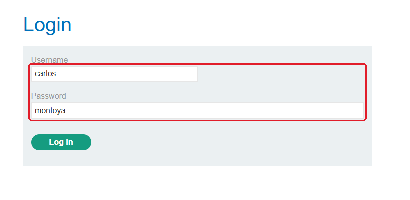
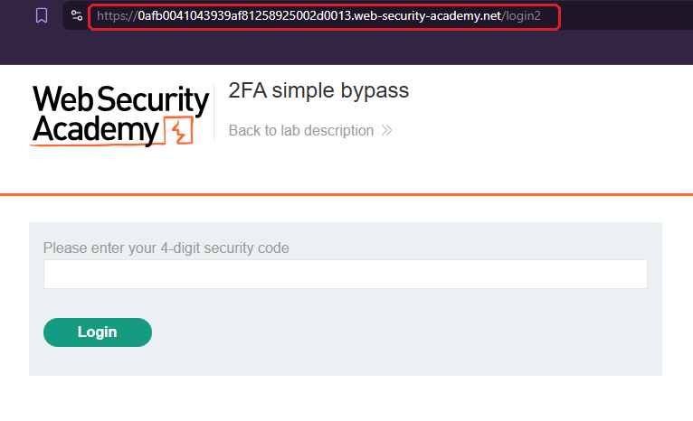
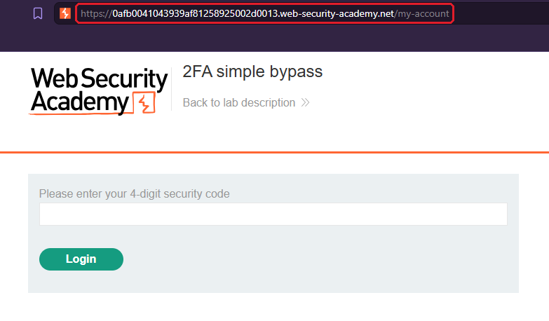
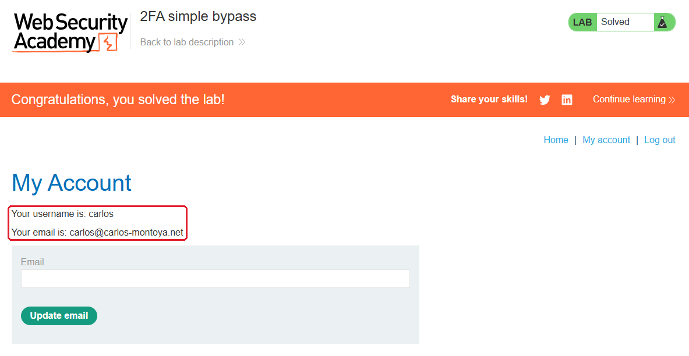

# 2FA simple bypass

**Plataforma:** [PortSwigger Web Security Academy](https://portswigger.net/web-security/authentication/multi-factor/lab-2fa-simple-bypass)  
**Nível:** Apprentice  
**Tema:** autenticação em dois fatores que dá para pular  
**Ferramentas:** só o navegador  

## O objetivo

Eu tenho o usuário e a senha da vítima (`carlos:montoya`), mas a conta dele tem autenticação em dois fatores (2FA). Depois da senha o site pede um código de 4 dígitos que vai para o e-mail do carlos, e eu não tenho acesso a esse e-mail. O objetivo é entrar na página da conta dele mesmo assim.

## Passo a passo

### 1. Logar com a conta da vítima

Preenchi o login com `carlos:montoya` e cliquei em "Log in". Essa é a primeira etapa, a que confere usuário e senha.

### 2. Cair na página do código

O site me mandou para `/login2`, que é a segunda etapa. Ela pede o código de 4 dígitos que foi para o e-mail. Sem o código eu não teria como passar daqui pelo caminho normal.

### 3. Pular a etapa do código trocando a URL

Em vez de tentar adivinhar o código, me perguntei o seguinte. Depois que eu passei pela senha, o site já me considera logado ou não? Se o login é dividido em duas etapas, pode ser que a primeira já crie a sessão e a segunda seja só uma tela no meio do caminho.

Para testar, troquei a URL na barra do navegador de `/login2` para `/my-account`, que é a página para onde o fluxo normal leva depois do código.

### 4. Lab resolvido

A página da conta abriu direto, com "Your username is: carlos", e o lab mudou para **Solved**. O código nunca foi digitado.

## Por que funcionou

O site divide o login em duas etapas. A primeira confere a senha e a segunda confere o código. O problema é que, assim que a senha é aceita, a sessão já fica marcada como logada. A etapa do código virou só uma página que o site espera que eu visite, mas nada me obriga a passar por ela.

Quando eu vou direto para `/my-account`, essa página só confere se a sessão está logada. Ela não pergunta se o segundo fator foi verificado. Na prática a conta estava protegida só pela senha, e a senha da vítima eu já tinha.

É parecido com o lab da [máquina de estados](../../Business-Logic/authentication-bypass-via-flawed-state-machine/). De novo o site confia que o usuário vai seguir as etapas na ordem certa, em vez de conferir no servidor em que ponto do fluxo a sessão está.

## Como corrigir

- Só considerar a sessão autenticada depois que todas as etapas forem concluídas. Depois da senha, a sessão deveria estar num estado de "falta o segundo fator", que não abre nenhuma página da conta.
- Conferir em toda página protegida se o 2FA foi verificado, e não só se existe uma sessão.
- Se a sessão tentar acessar outra página no meio do login, mandar de volta para a etapa do código ou derrubar o login.

## O que eu aprendi

2FA só protege se o servidor realmente exigir a segunda etapa. Quando um login tem várias telas, a primeira coisa a testar é pular uma delas e ir direto para onde o fluxo termina. Foi o lab mais rápido até agora, e é justamente por isso que vale lembrar dele. Às vezes a falha não precisa de nenhuma ferramenta, só de trocar a URL e ver o que o site faz.
