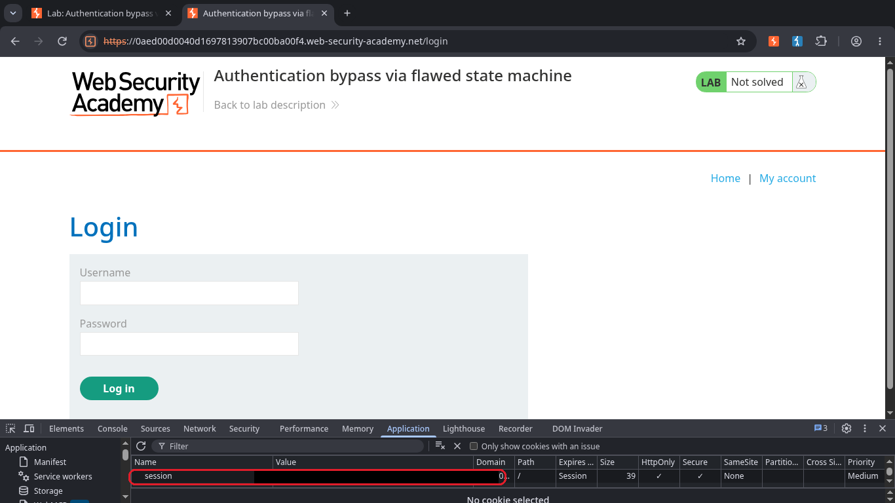
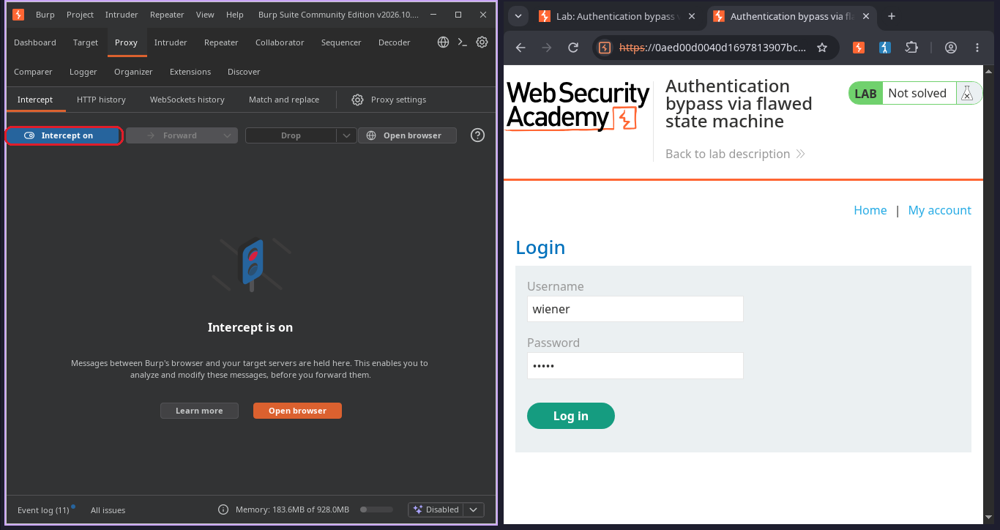
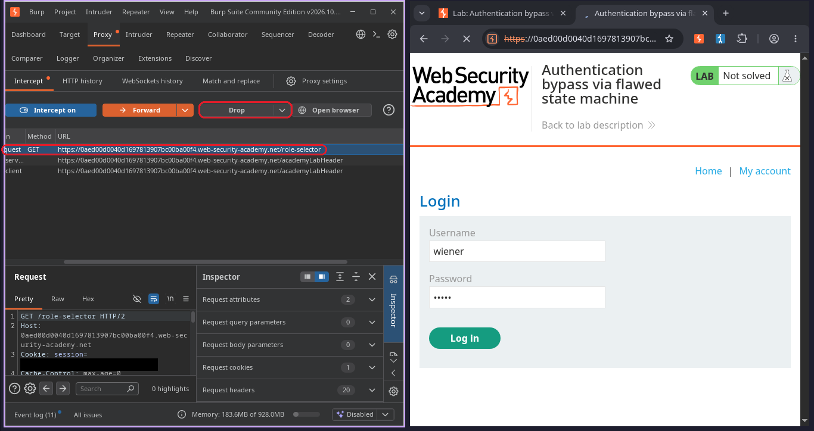
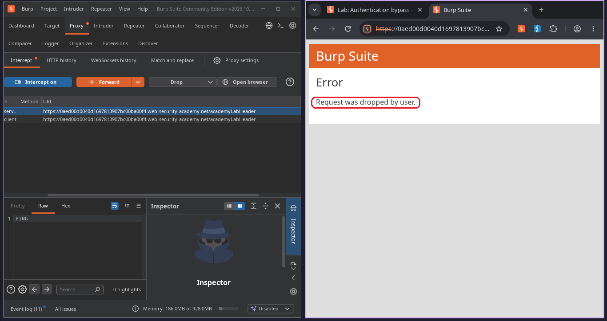
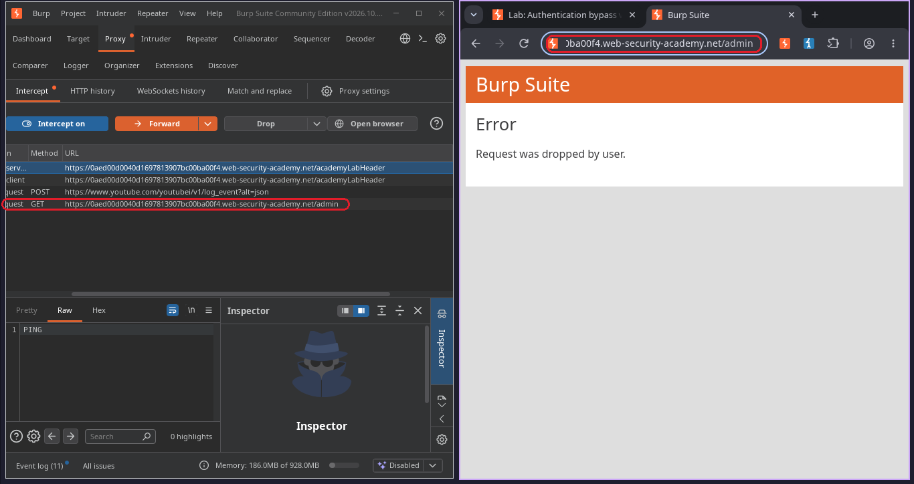
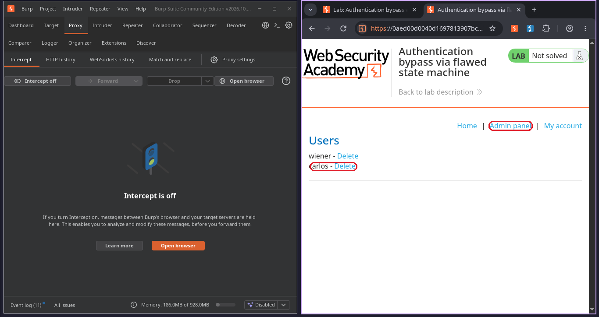
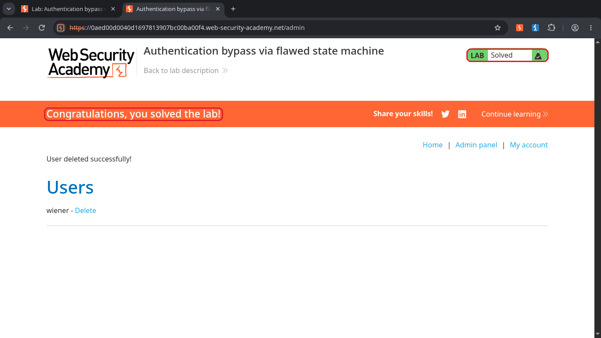

# Authentication bypass via flawed state machine

**Plataforma:** [PortSwigger Web Security Academy](https://portswigger.net/web-security/logic-flaws/examples/lab-logic-flaws-authentication-bypass-via-flawed-state-machine)  
**Nível:** Practitioner  
**Tema:** falha de lógica de negócio (máquina de estados) que vira bypass de autenticação  
**Ferramentas:** Burp Suite (Proxy e Intercept), gobuster para descoberta de conteúdo  

## O objetivo

O site tem um painel de administração em `/admin` e o objetivo é deletar o usuário `carlos` por lá. Eu tenho uma conta normal (`wiener:peter`), mas o painel só abre para administrador.

Antes de começar rodei um gobuster para confirmar que o `/admin` existia de verdade. Ele respondeu `401`, ou seja, o caminho existe mas eu não tenho acesso com a conta que tenho. Esse 401 já foi uma pista. Se o caminho existe e só está trancado, a pergunta vira "como eu chego nesse estado de administrador sem ter a senha de um".

A parte mais importante desse lab para mim não foi o passo a passo e sim o raciocínio. Eu não escalei privilégio. Eu só impedi o site de me rebaixar.

## Passo a passo

### 1. Reparar que eu já tenho um cookie de sessão antes de logar

Antes de digitar usuário e senha, abri o DevTools na aba Application e vi que já existia um cookie `session`. Isso me chamou atenção. O site já guarda um estado meu antes de eu me autenticar. Sempre que um fluxo tem várias etapas e já me entrega um estado assim cedo, vale desconfiar e perguntar em que estado eu estou em cada ponto do caminho.

### 2. Ligar o Intercept e começar o login

Liguei o proxy do Burp, deixei o Intercept ligado e preenchi o login com `wiener:peter`. A ideia aqui é ver cada requisição do processo de login uma por uma, porque é no meio dessa sequência que mora a falha.

### 3. Achar o GET /role-selector e dropar essa requisição

Dei `Forward` no `POST /login` normal. A requisição seguinte foi um `GET /role-selector`. Essa é a etapa em que o site define o meu papel (usuário comum ou content author). Em vez de deixar ela passar, cliquei em `Drop`. Com isso essa etapa de definir papel nunca acontece.

### 4. Confirmar que a requisição foi dropada

O Burp mostrou a mensagem "Request was dropped by user". Confirmado. O servidor nunca recebeu a etapa de seleção de papel, então minha sessão ficou parada no estado que vem logo depois do login.

### 5. Trocar a URL para /admin

Com a sessão parada nesse estado, troquei a URL na barra do navegador direto para `/admin`. Aquele mesmo caminho que antes dava 401.

### 6. Cair no painel admin e deletar o carlos

Desliguei o Intercept e o painel de administração abriu. Apareceu a lista de usuários com `wiener` e `carlos`. Cliquei em "Delete" no carlos.

### 7. Lab resolvido

A mensagem "User deleted successfully" apareceu e o lab mudou para **Solved**.

## Por que funcionou

O site trata o login em duas partes. Primeiro o `POST /login` confere usuário e senha. Depois o `role-selector` define qual papel a sessão vai ter.

A falha é que o papel padrão, logo depois do login e antes da seleção, já é o de administrador. O `GET /role-selector` é justamente a etapa que tira a sessão desse estado de administrador e me coloca como usuário comum. Em outras palavras, a seleção de papel existe para me rebaixar, não para me promover.

Quando eu dropo o `GET /role-selector`, essa etapa de rebaixamento nunca roda. Minha sessão fica no estado padrão, que é o de administrador. Por isso eu digo que não houve escalação de privilégio. Eu só evitei perder um privilégio que o site me deu cedo demais.

O erro de fundo é o site assumir que o fluxo sempre vai ser concluído na ordem certa, em vez de conferir o meu papel de verdade na hora que eu bato no `/admin`.

## Como corrigir

- Nunca deixar o papel padrão ser um papel privilegiado. Enquanto a seleção não acontece de forma válida, a sessão deveria estar no menor privilégio possível ou em nenhum.
- Conferir a autorização dentro do próprio `/admin`, checando o papel atual da sessão, em vez de confiar que o fluxo de login terminou direito.
- Tratar o login como não finalizado até a sequência inteira ter sido validada no servidor. Pular ou dropar uma etapa não pode deixar a sessão num estado melhor do que o fluxo completo deixaria.

## O que eu aprendi

Fluxo com várias etapas é um lugar ótimo para procurar falha. A sacada é mexer na sequência e observar o que muda no meu acesso. Dá para pular uma etapa, dropar uma etapa, repetir, inverter a ordem ou dar replay numa requisição antiga, e depois comparar o antes e o depois.

A primeira pista foi o cookie de sessão que apareceu antes de eu logar. Ele mostrou que o site já guardava um estado meu cedo demais. A segunda foi comparar o `/admin` em momentos diferentes do fluxo. Trancado com a conta normal, aberto quando a sessão parou no estado certo. A mesma sessão teve acesso diferente só por causa de onde ela parou no caminho.

E a lição que eu quero levar para os próximos labs é essa. Nem todo bypass é ganhar um poder novo. Às vezes é só impedir o site de tirar um poder que ele te deu sem querer. Isso cai direto no que o OWASP chama de teste de lógica de negócio, na parte de burlar fluxos de trabalho (WSTG-BUSL).
