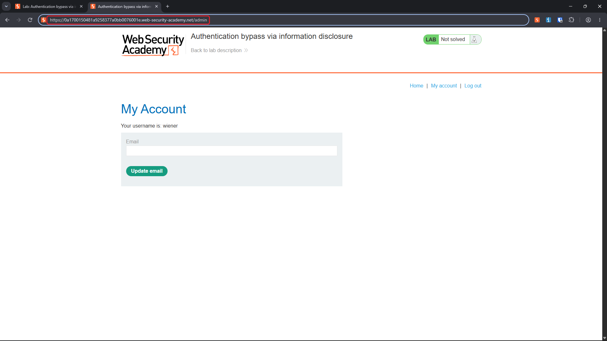
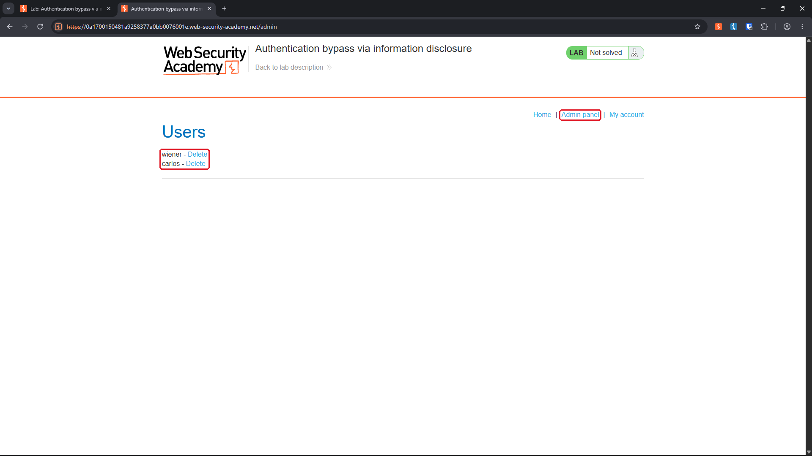

# Authentication bypass via information disclosure

**Plataforma:** [PortSwigger Web Security Academy](https://portswigger.net/web-security/information-disclosure/exploiting/lab-infoleak-authentication-bypass)  
**Nível:** Practitioner  
**Tema:** bypass de autenticação por um header de IP que o servidor confia, descoberto com o método TRACE  
**Ferramentas:** Burp Suite (Proxy, Repeater e Match and replace)  

## O objetivo

O site tem um painel de administração em `/admin` e o objetivo é deletar o usuário `carlos` por lá. Eu tenho uma conta normal (`wiener:peter`), que não tem acesso ao painel.

O lab junta duas falhas. A primeira é o servidor revelar informação que não deveria. A segunda é o `/admin` liberar acesso com base num dado que o cliente consegue forjar. A primeira serve para descobrir como explorar a segunda.

## Passo a passo

### 1. Abrir o /admin e ler a mensagem de erro

Acessei o `/admin` direto pela URL. A página não só negou o acesso como explicou o critério: "Admin interface only available to local users". Ou seja, o painel abre para requisições que vêm do próprio servidor (localhost).

Essa mensagem já é divulgação de informação. O servidor contou qual é a regra de acesso. A pergunta vira "como o servidor decide se uma requisição é local?".


### 2. Interceptar o GET /admin

Liguei o Intercept no Burp e acessei o `/admin` de novo para pegar a requisição.


### 3. Mandar para o Repeater e confirmar o 401

Mandei a requisição para o Repeater com `Ctrl+R` e enviei. A resposta foi `401 Unauthorized`, que quer dizer "não autorizado". É a base de comparação para os próximos testes.


### 4. Trocar o método para TRACE

O `TRACE` é um método HTTP de diagnóstico, assim como `GET` e `POST` são métodos. Quando o servidor aceita um `TRACE`, ele responde devolvendo no corpo a requisição que recebeu, do jeito que ela chegou até ele.

A utilidade disso aqui é ver a requisição do ponto de vista do servidor. Entre o navegador e a aplicação costuma existir algum intermediário, como um proxy reverso ou um balanceador de carga, e ele pode acrescentar headers antes de repassar a requisição. Esses headers não aparecem no Burp, porque o Burp mostra a requisição antes de ela sair para a rede.

Troquei o `GET` por `TRACE` na primeira linha e enviei. A resposta veio `200 OK` com a requisição ecoada, e no final dela apareceu um header que não estava na requisição original:

```
X-Custom-IP-Authorization: <meu IP>
```

Esse header foi adicionado no meio do caminho com o meu IP público (censurado no print). É ele que a aplicação usa para decidir se a requisição é local.

Um ponto que pode confundir: o `TRACE` não dá acesso ao painel. Ele só serve de reconhecimento, porque revela o nome do header e mostra que ele é o critério de acesso.


### 5. Abrir o Match and replace do Proxy

Com o nome do header em mãos, o próximo passo é mandar esse header com o valor do localhost. Em vez de editar cada requisição manualmente, usei o "Match and replace" do Proxy, que aplica uma regra automática em toda requisição que passa pelo Burp. Fui na aba e cliquei em "Add".


### 6. Criar a regra que adiciona o header

Configurei a regra assim:

- **Type:** `Request header`, para a regra agir nos headers da requisição.
- **Match:** vazio. Sem nada para procurar, o Burp não substitui nenhum header existente, só acrescenta um novo.
- **Replace:** `X-Custom-IP-Authorization: 127.0.0.1`. O `127.0.0.1` é o endereço de loopback, que uma máquina usa para se comunicar com ela mesma. É o valor que o servidor considera local.


### 7. Testar a regra

Antes de salvar, cliquei em "Test". No lado "Auto-modified request" o header `X-Custom-IP-Authorization: 127.0.0.1` apareceu junto dos outros headers. A regra está funcionando, então dei OK.


### 8. Desligar o Intercept

Desliguei o Intercept para as requisições passarem direto. A partir daqui, toda requisição que sai do navegador pelo Burp já leva o header com `127.0.0.1`.


### 9. Voltar para o /admin

Logado como `wiener`, troquei a URL para `/admin` de novo.



### 10. Painel aberto

Dessa vez o painel abriu, com a lista de usuários e o link "Admin panel" no menu. A aplicação leu o header com `127.0.0.1`, tratou a requisição como local e liberou o acesso.



### 11. Deletar o carlos e lab resolvido

Cliquei em "Delete" no carlos. Apareceu "User deleted successfully!" e o lab mudou para **Solved**.


## Por que funcionou

A aplicação decide se a requisição é local lendo o `X-Custom-IP-Authorization`. A intenção é que esse header seja definido só pelo intermediário, com o IP real de quem acessa. O problema é que nada impede o cliente de mandar o mesmo header, e a aplicação não tem como distinguir um valor colocado pelo intermediário de um valor enviado por mim. Ela toma uma decisão de acesso com base num dado que o cliente controla.

A mensagem de erro do `/admin` e o `TRACE` habilitado são as falhas de divulgação de informação. Sozinhas elas não abrem o painel, mas entregaram tudo que faltava. A mensagem revelou a regra de acesso e o `TRACE` revelou o nome do header que implementa essa regra.

## Como corrigir

- Não usar headers de IP que o cliente consegue enviar, como `X-Forwarded-For`, `X-Real-IP` ou um customizado como esse, para decidir acesso. O painel de admin deveria exigir uma sessão de administrador.
- Se a aplicação depende mesmo desse header, o intermediário precisa descartar qualquer versão enviada pelo cliente e sempre sobrescrever com o valor correto.
- Desabilitar o método `TRACE` em produção. Isso não corrige a falha principal, mas tira uma forma fácil de enxergar o que acontece entre o cliente e a aplicação.
- Não explicar o critério de acesso na mensagem de erro. Um "acesso negado" genérico já basta.

## O que eu aprendi

A falha principal aqui não é o `TRACE`, é confiar num dado controlado pelo cliente para decidir quem pode entrar. Uma forma de separar a falha do que só facilitou a exploração é perguntar: com o `TRACE` desabilitado, o ataque ainda seria possível? Seria. Descobrir o nome do header ficaria mais difícil, mas ainda daria para testar uma lista de nomes comuns até um funcionar. A falha continuaria lá.

Dois hábitos para os próximos labs. Ler com atenção as mensagens de erro, porque elas podem revelar a regra que está por trás do bloqueio. E testar outros métodos HTTP além de `GET` e `POST`, que o OWASP cobre na parte de teste de métodos HTTP (WSTG-CONF-06). O Match and replace do Burp também fica no repertório para quando for preciso mandar o mesmo header em toda requisição.
