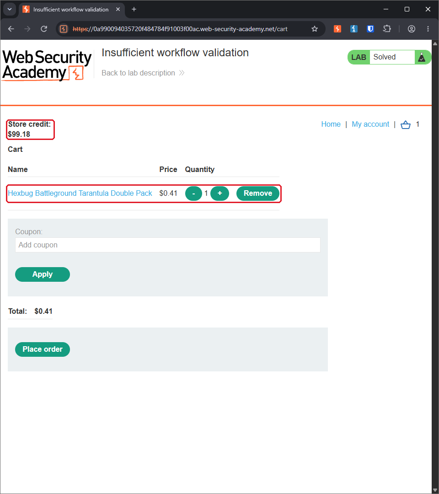
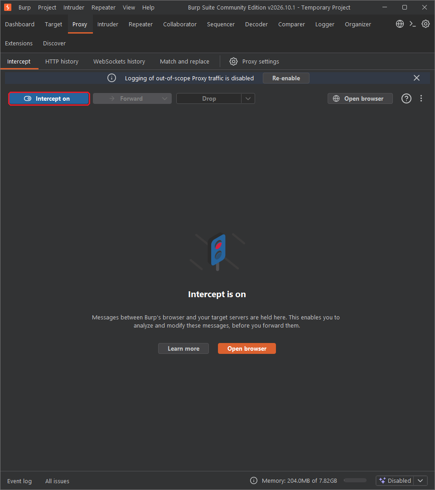
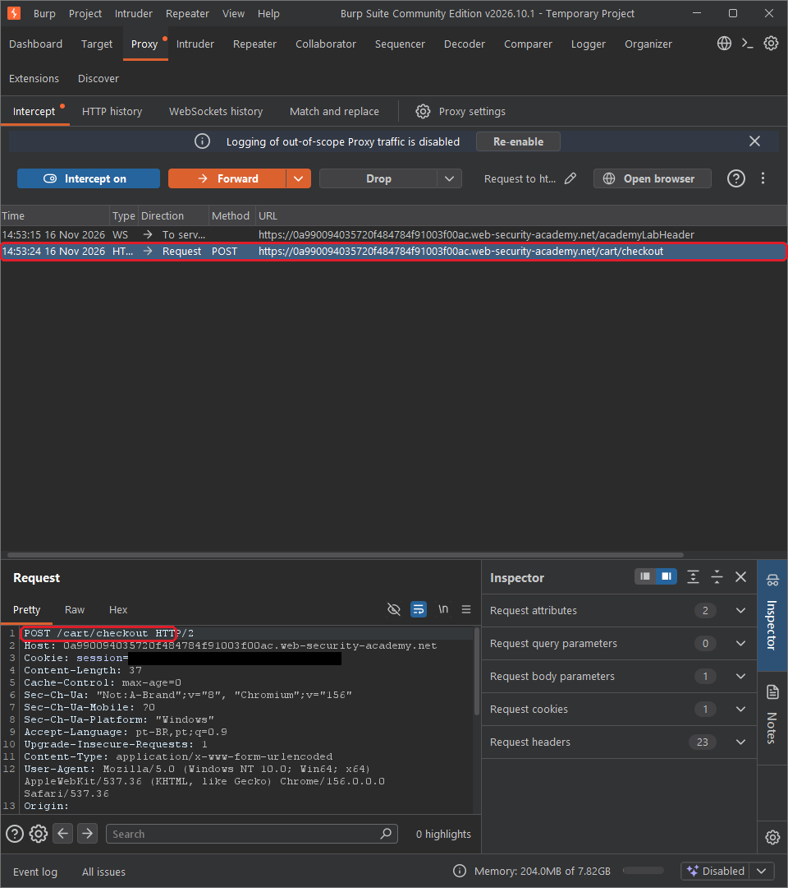
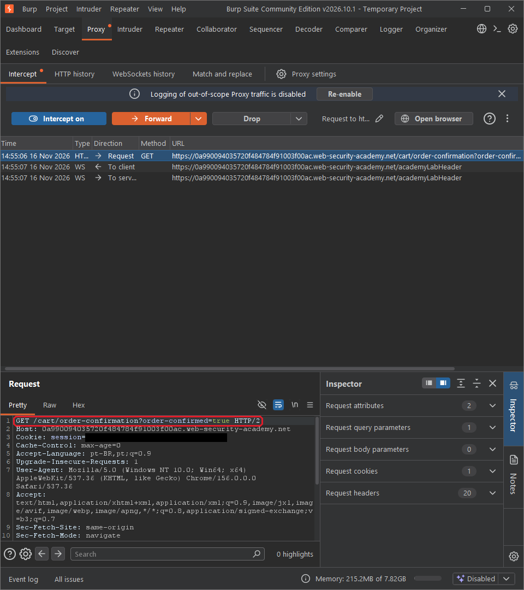
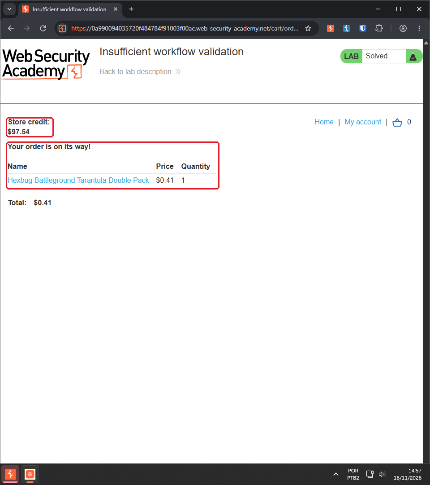
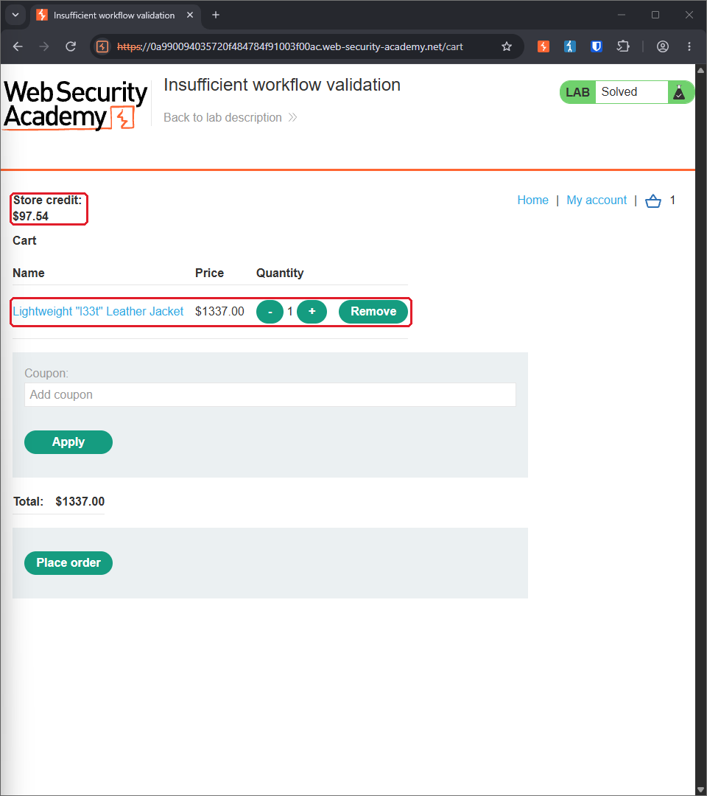
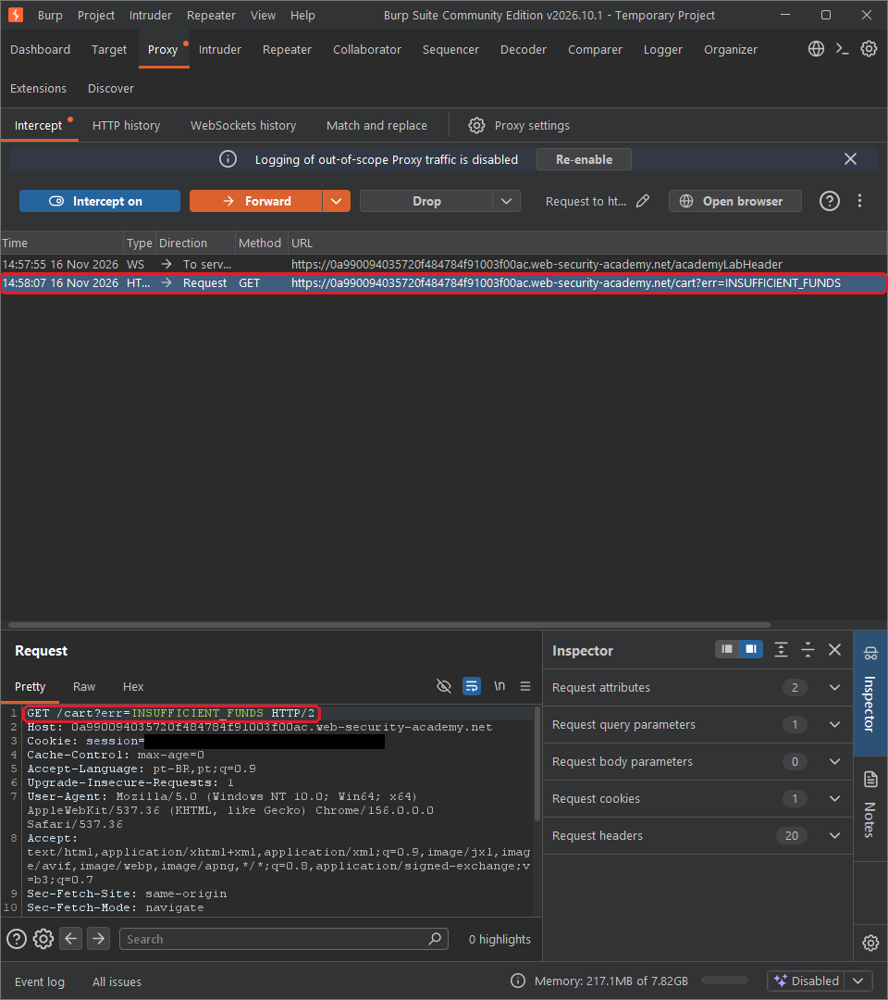
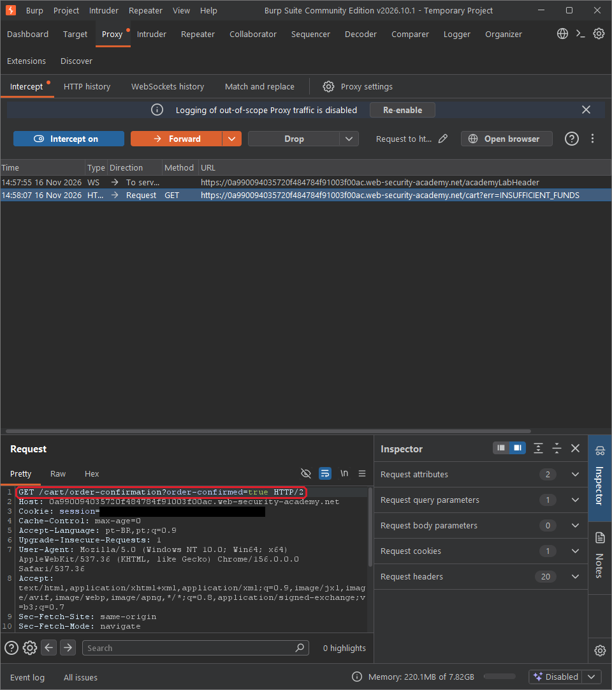
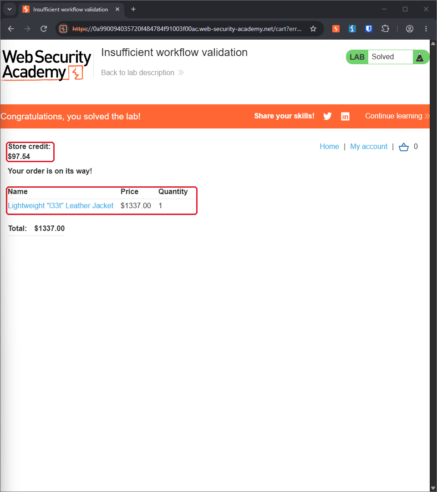

# Insufficient workflow validation

**Plataforma:** [PortSwigger Web Security Academy](https://portswigger.net/web-security/logic-flaws/examples/lab-logic-flaws-insufficient-workflow-validation)  
**Nível:** Practitioner  
**Tema:** falha de lógica de negócio, uma etapa do fluxo de compra que dá para pular  
**Ferramentas:** Burp Suite (Proxy e Intercept)  

## O objetivo

O lab é uma loja online. Eu tenho uma conta normal (`wiener:peter`) com um pouco menos de 100 dólares de crédito, e o objetivo é comprar a "Lightweight l33t Leather Jacket", que custa $1337. Ou seja, comprar algo que eu não tenho dinheiro para pagar.

Assim como no lab da [máquina de estados](../../Authentication/authentication-bypass-via-flawed-state-machine/), o segredo aqui é entender o fluxo antes de atacar. Primeiro eu vi como é uma compra que dá certo, e só depois tentei a que dá errado.

## Passo a passo

### 1. Colocar um item barato no carrinho

Para ver o fluxo de compra completo, eu precisava de uma compra que o meu crédito cobrisse. Coloquei no carrinho um item de $0.41. O crédito da loja aparece no canto esquerdo.



### 2. Ligar o Intercept

Liguei o Intercept no Burp para ver uma por uma as requisições que acontecem quando eu clico em "Place order".



### 3. Ver o POST /cart/checkout

Cliquei em "Place order" e a primeira requisição foi um `POST /cart/checkout`. É aqui que o servidor confere se eu tenho crédito para pagar o carrinho.



### 4. Ver para onde o checkout me manda quando dá certo

Dei `Forward` no checkout. Como o crédito cobria o item, a próxima requisição foi um `GET /cart/order-confirmation?order-confirmed=true`. Esse é o passo que confirma o pedido.

Essa é a requisição mais importante do lab. Ela é separada do checkout e não leva nada além de um `order-confirmed=true` na URL.



### 5. Pedido concluído

Deixei passar e o pedido foi concluído com "Your order is on its way!". O crédito foi descontado normalmente. Agora eu já sei como é o caminho de uma compra que dá certo: `POST /cart/checkout` e depois `GET /cart/order-confirmation?order-confirmed=true`.



### 6. Colocar a jaqueta no carrinho

Agora sim coloquei a jaqueta de $1337 no carrinho. O crédito continua em $97.54, muito longe do preço.



### 7. Ver o que o checkout faz quando falta dinheiro

Com o Intercept ainda ligado, cliquei em "Place order" e dei `Forward` no `POST /cart/checkout`. Dessa vez o servidor não me mandou para a confirmação. A requisição seguinte foi um `GET /cart?err=INSUFFICIENT_FUNDS`, ou seja, de volta para o carrinho com o erro de saldo insuficiente.



### 8. Trocar a requisição pela de confirmação

Aqui entra o que eu aprendi na compra que deu certo. Em vez de deixar o `GET /cart?err=INSUFFICIENT_FUNDS` passar, editei a primeira linha da requisição no próprio Intercept e coloquei no lugar a requisição de confirmação:

```
GET /cart/order-confirmation?order-confirmed=true HTTP/2
```



### 9. Lab resolvido

Dei `Forward` e desliguei o Intercept. A página mostrou "Your order is on its way!" com a jaqueta de $1337 no pedido, e o lab mudou para **Solved**. Repare que o crédito continuou em $97.54. A jaqueta saiu de graça.



## Por que funcionou

O site divide a compra em duas etapas. O `POST /cart/checkout` confere se eu tenho crédito e, se tiver, me manda para a confirmação. O `GET /cart/order-confirmation?order-confirmed=true` fecha o pedido com o que estiver no carrinho.

A falha é que a confirmação não confere se o checkout foi aprovado. Ela assume que, se eu cheguei nela, é porque passei pela etapa anterior com sucesso. Só que eu posso pedir essa URL quando eu quiser. A validação do saldo existe, mas fica numa etapa que dá para pular.

O `order-confirmed=true` na URL deixa isso ainda mais claro. A decisão de que o pedido foi confirmado está numa coisa que eu controlo, e não no estado guardado no servidor.

## Como corrigir

- Validar tudo de novo na etapa que realmente fecha o pedido. A confirmação deveria conferir o saldo e o valor do carrinho antes de concluir, sem confiar que o checkout já fez isso.
- Guardar no servidor, junto da sessão, que o checkout daquele carrinho foi aprovado, e só aceitar a confirmação se esse registro existir e bater com o carrinho atual.
- Não deixar um parâmetro da URL como `order-confirmed=true` decidir nada. Quem diz se o pedido foi confirmado é o servidor.
- Descontar o crédito e confirmar o pedido numa única operação, para não existir um momento em que um acontece sem o outro.

## O que eu aprendi

O jeito de achar essa falha foi fazer primeiro a compra que dá certo e anotar cada requisição do caminho. Com o caminho feliz mapeado, ficou fácil ver qual etapa fazia a validação e qual só concluía o pedido. Daí a pergunta é sempre a mesma: e se eu for direto para a etapa final?

É a mesma ideia de dois labs que fiz em autenticação, o do [2FA simple bypass](../../Authentication/2fa-simple-bypass/) e o da máquina de estados. Nos três, o site espera que o usuário siga as etapas na ordem e não confere no servidor se isso aconteceu. No 2FA foi pular o código, na máquina de estados foi dropar a seleção de papel, e aqui foi pular a validação do saldo. O OWASP trata desse tipo de teste na parte de lógica de negócio, em burlar fluxos de trabalho (WSTG-BUSL).
