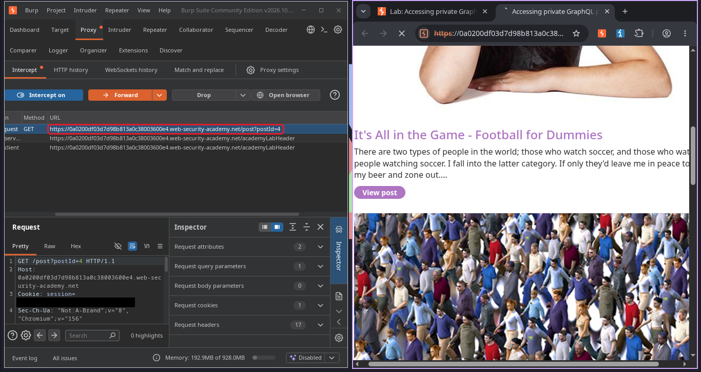
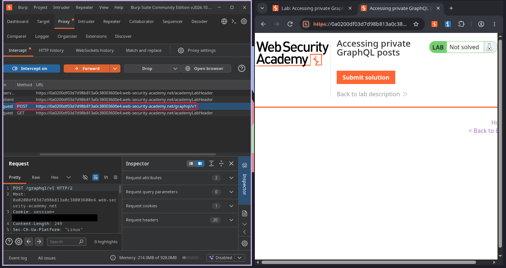
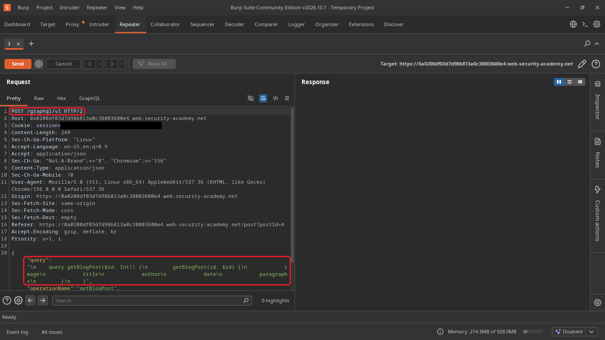
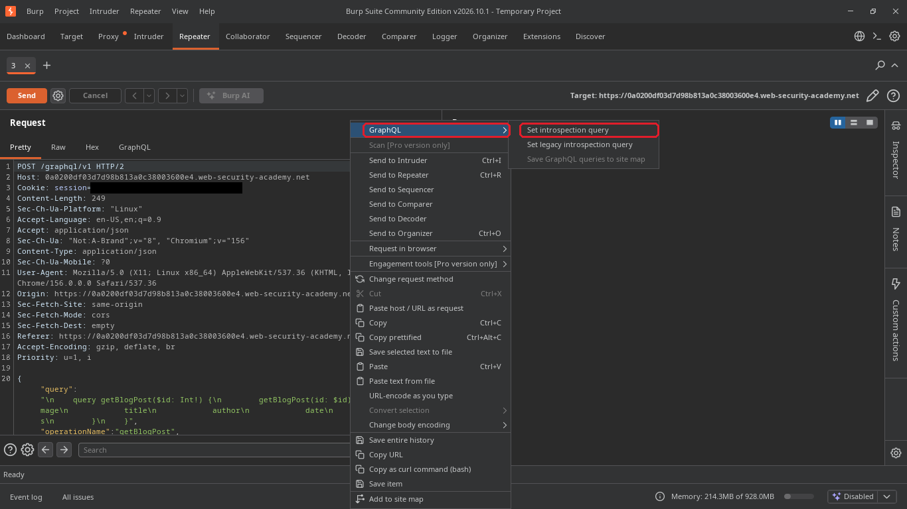
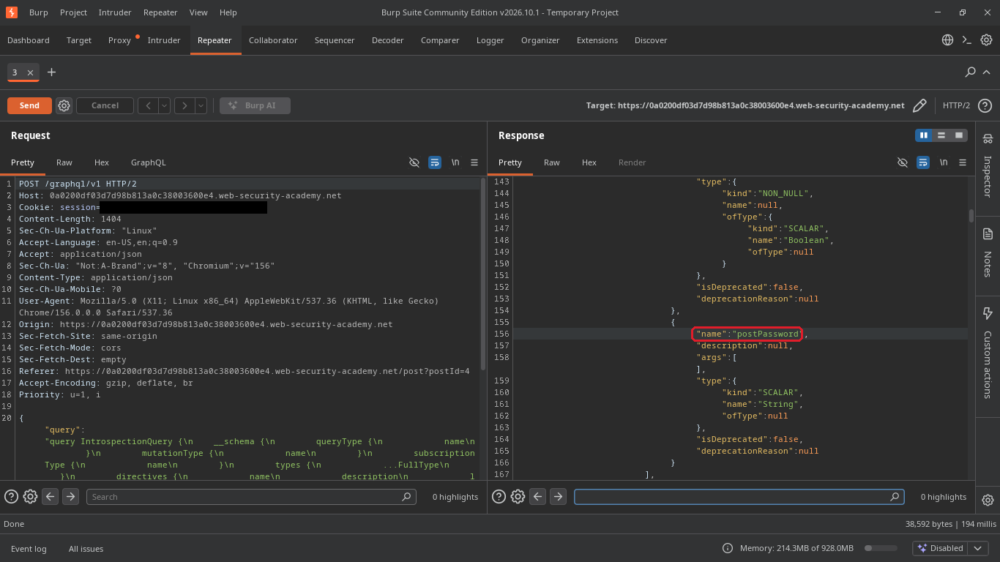
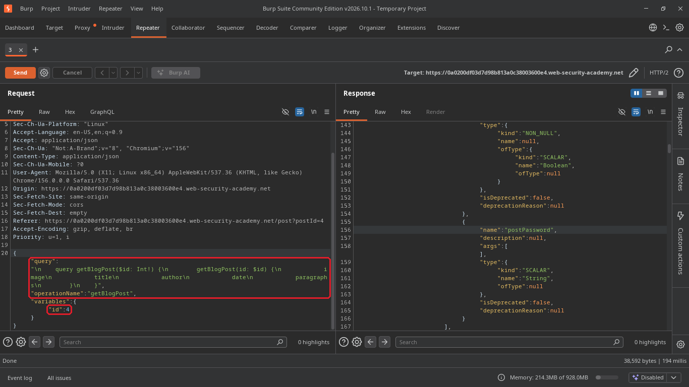
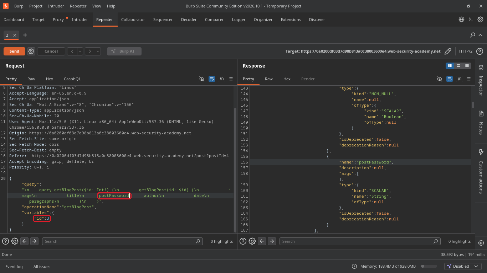
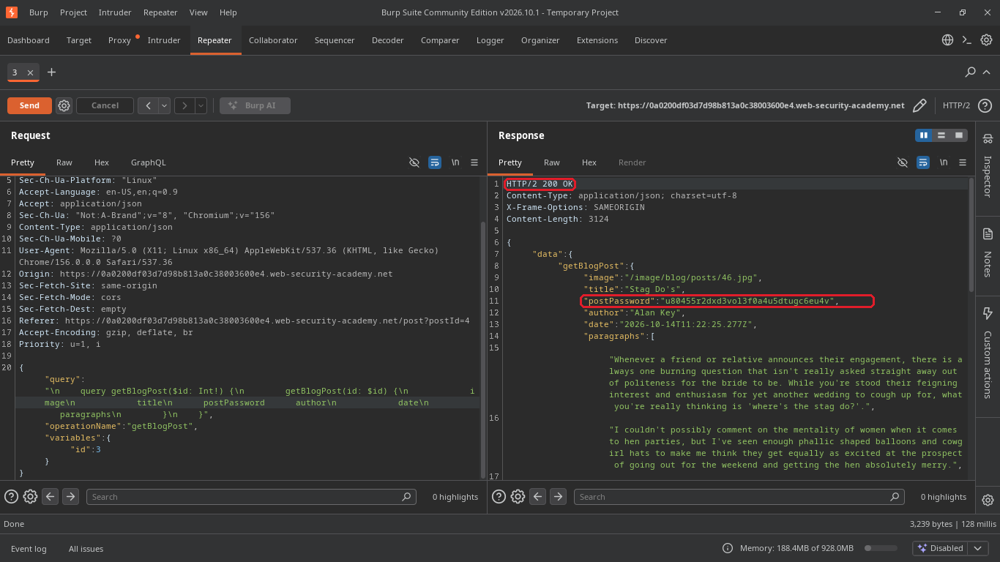
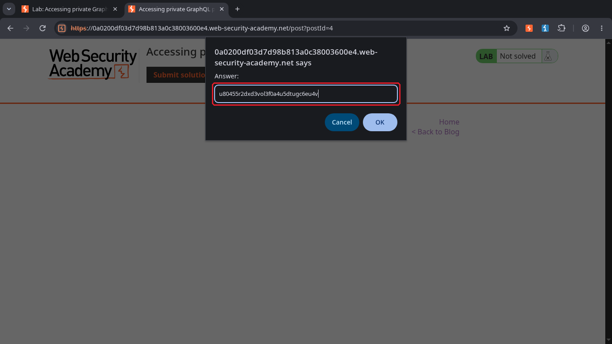
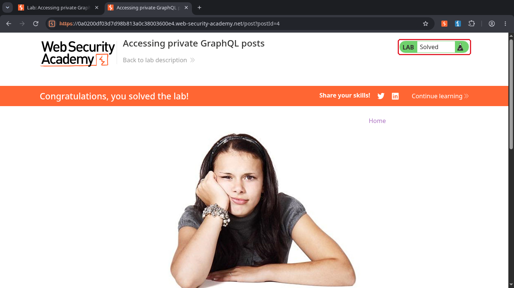

# Accessing private GraphQL posts

**Plataforma:** [PortSwigger Web Security Academy](https://portswigger.net/web-security/graphql/lab-graphql-reading-private-posts)  
**Nível:** Apprentice  
**Tema:** GraphQL (introspecção + post escondido acessível pelo id)  
**Ferramentas:** Burp Suite (Proxy e Repeater)  

## O objetivo

O blog do lab tem um post escondido, e esse post guarda uma senha. O objetivo é achar essa senha e enviar como resposta no botão "Submit solution".

## Passo a passo

### 1. Desconfiar do post que falta e interceptar a abertura de um post

Na página inicial aparecem 4 posts. Abrindo cada um, os ids são 1, 2, 4 e 5. Se os ids são sequenciais, cadê o 3? Provavelmente ele existe e só está escondido.

Para entender como o site busca os posts, liguei o Burp como proxy, ativei o Intercept e cliquei em "View post". A primeira requisição que aparece é um `GET /post?postId=4`, que só carrega a página.

### 2. Achar a requisição para o GraphQL

Cliquei em "Forward" para deixar essa passar. Logo depois apareceu uma requisição `POST` para `/graphql/v1`. É ela que busca de verdade o conteúdo do post na API.

### 3. Mandar para o Repeater

Mandei essa requisição para o Repeater com `Ctrl+R`. No corpo dá para ver a query `getBlogPost`, que pede só alguns campos do post: `image`, `title`, `author`, `date` e `paragraphs`.

### 4. Pedir o mapa da API com uma introspection query

O GraphQL tem um recurso chamado introspecção, que deixa perguntar para a própria API quais tipos e campos ela tem. O Burp já monta essa pergunta pronta: cliquei com o botão direito na requisição, fui em "GraphQL" e depois em "Set introspection query".

### 5. Encontrar o campo postPassword

Enviei a requisição e a resposta veio com o esquema inteiro da API. Lendo o tipo `BlogPost`, achei um campo que o site nunca pede: `postPassword`.

### 6. Voltar para a query original

Desfiz a introspecção com `Ctrl+Z` até voltar para a query original do post. Repare no final: ela busca o post pelo id que vai em `variables`, e aqui ele é o `4`.

### 7. Pedir o post 3 com o campo da senha

Fiz duas mudanças na mesma requisição: troquei o `id` de `4` para `3` e acrescentei `postPassword` junto dos outros campos da query.

### 8. Ler a senha na resposta

Enviei e a resposta veio com `200 OK` e o post 3 inteiro, um post chamado "Stag Do's" que não aparece no blog. Junto dos outros campos veio o `postPassword`: `u80455r2dxd3vol3f0a4u5dtugc6eu4v`.

### 9. Enviar a resposta

Voltei no navegador, cliquei em "Submit solution" e colei a senha.

### 10. Lab resolvido

O lab foi marcado como **Solved**.

## Por que funcionou

O post 3 estava escondido só na tela. A página inicial não lista ele, mas a API continua entregando o post para qualquer um que peça pelo id. Ninguém confere se aquele post pode ser visto.

O campo `postPassword` tem o mesmo problema. O site não pede esse campo, mas ele existe no esquema e a API devolve para quem pedir. No GraphQL é o cliente que escolhe os campos, então esconder um campo no front-end não protege nada.

E a introspecção ligada foi o que me deu o mapa. Sem ela eu teria que adivinhar o nome `postPassword`. Com ela, a própria API me contou que o campo existia.

## Como corrigir

- Conferir a permissão dentro do resolver do `getBlogPost`. Post escondido só volta para quem tem acesso a ele.
- Colocar controle de acesso por campo. Um campo sensível como `postPassword` não pode ser devolvido para qualquer usuário. Melhor ainda é nem expor esse campo no esquema público.
- Desligar a introspecção em produção. Isso não corrige a falha sozinho, mas tira o mapa da mão de quem está procurando.

## O que eu aprendi

Um buraco na sequência de ids já é uma pista. Se tem 1, 2, 4 e 5, vale a pena testar o 3. No GraphQL, o primeiro passo é rodar a introspecção e ler o esquema com calma, porque ali aparecem campos que o site nunca mostra. E de novo a mesma lição dos labs de IDOR: esconder algo na tela não é a mesma coisa que proteger no servidor.
