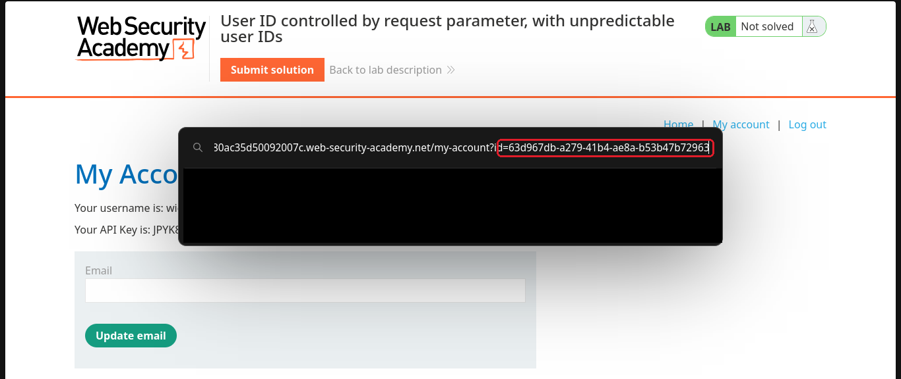
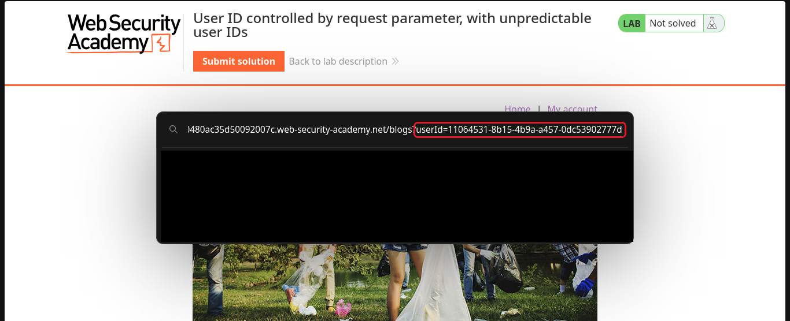
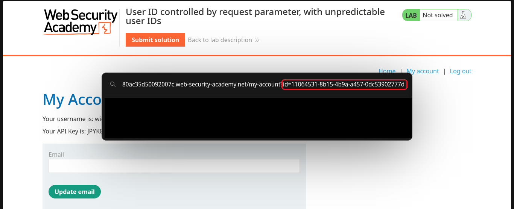
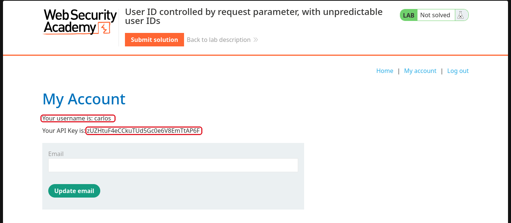

# User ID controlled by request parameter, with unpredictable user IDs

**Plataforma:** [PortSwigger Web Security Academy](https://portswigger.net/web-security/access-control/lab-user-id-controlled-by-request-parameter-with-unpredictable-user-ids)  
**Nível:** Apprentice  
**Tema:** controle de acesso (IDOR)  
**Ferramentas:** só o navegador  

## O objetivo

Mesma ideia do lab anterior, achar a API key do carlos. A diferença é que agora o `id` da conta não é o nome de usuário, é um UUID, aquele código grande e aleatório. Um UUID não dá para adivinhar, então eu preciso encontrá-lo em algum lugar.

## Passo a passo

### 1. Olhar a minha conta

Logado como wiener, reparei que o endereço da minha conta usa um UUID como `id`.

### 2. Procurar o UUID do carlos no blog

Como não dá para adivinhar, fui atrás. Navegando pelo blog do site, achei um post escrito pelo carlos.

### 3. Achar o UUID na página do autor

Cliquei no nome do carlos. A página que lista os posts dele usa o UUID dele no endereço, em `blogs?userId=...`. Era exatamente o que eu precisava.

### 4. Trocar o UUID na minha conta

Copiei o UUID do carlos e coloquei no lugar do meu, em `my-account?id=...`.

### 5. Cair na conta do carlos e resolver

A página abriu a conta do carlos com a API key dele. Colei na solução.

## Por que funcionou

Mesmo com um UUID, que ninguém consegue adivinhar, o site continua sem conferir se a conta é minha. Então a troca funciona igual ao lab anterior.

O detalhe novo é que o UUID do carlos, que deveria ser difícil de conseguir, estava à mostra em outra parte do site, no endereço dos posts dele. Com isso eu nem precisei adivinhar nada. O UUID deixou de ser segredo no momento em que apareceu numa página pública.

## Como corrigir

- O principal é o mesmo do lab anterior, conferir se a conta é de quem está pedindo antes de mostrar.
- Além disso, não deixar o identificador vazar em lugares públicos, como o endereço dos posts. Se ele precisa aparecer ali, o controle de acesso não pode depender dele ser difícil de adivinhar.

## O que eu aprendi

Um UUID só protege se for segredo de verdade. Se ele aparece em outro canto do site, a dificuldade de adivinhar não vale nada. Controle de acesso não pode se apoiar no identificador ser aleatório, e sim em checar quem tem direito de ver o quê.
