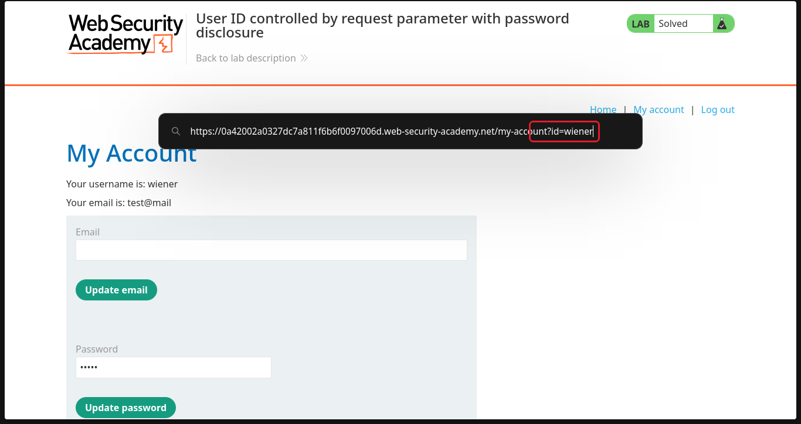
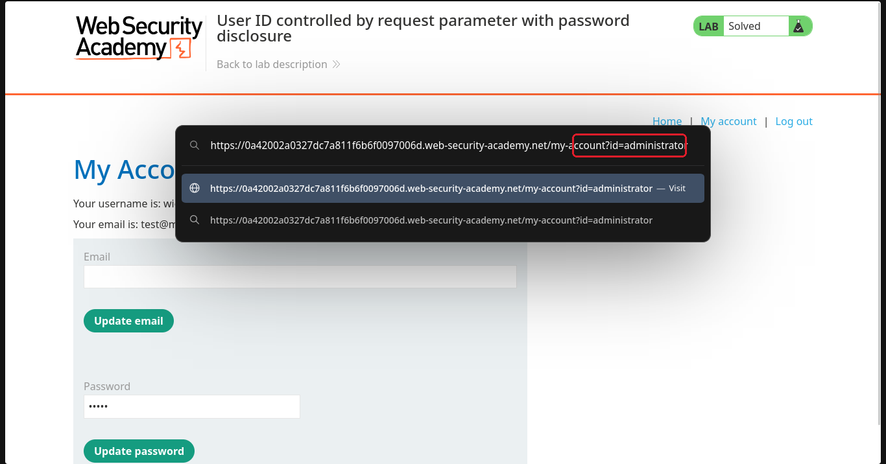
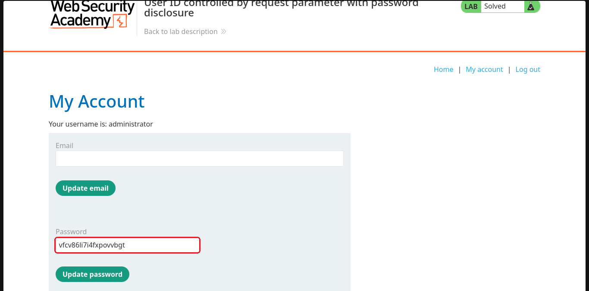
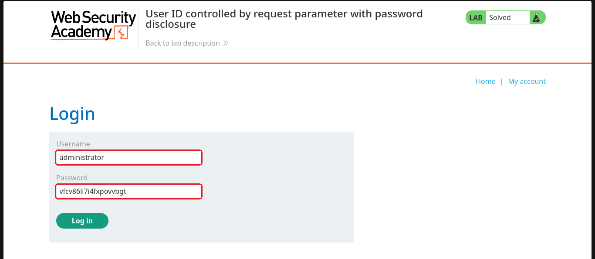
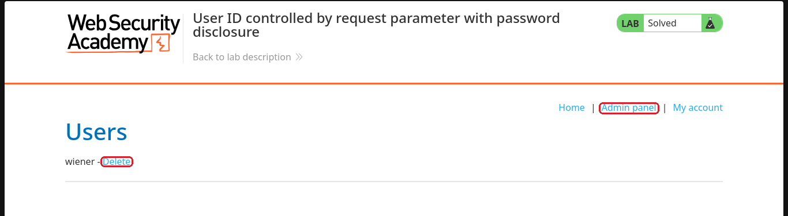

# User ID controlled by request parameter with password disclosure

**Plataforma:** [PortSwigger Web Security Academy](https://portswigger.net/web-security/access-control/lab-user-id-controlled-with-password-disclosure)  
**Nível:** Apprentice  
**Tema:** controle de acesso (IDOR) + exposição de senha  
**Ferramentas:** só o navegador  

## O objetivo

Entrar com a minha conta (wiener) e descobrir a senha do administrator para, logado como ele, apagar o usuário carlos.

## Passo a passo

### 1. Olhar a minha conta

Fiz login como wiener. A página "My Account" mostra o meu nome de usuário e, mais abaixo, um campo de senha já preenchido, mas escondido com bolinhas. Repare que o endereço termina em `my-account?id=wiener`: quem decide qual conta aparecer é esse `id`, e o meu `id` é o meu próprio nome de usuário.

### 2. Trocar o id para administrator

Como o objetivo do lab é o administrator, troquei `wiener` por `administrator` no endereço e dei enter.

### 3. Cair na conta do administrator e revelar a senha

A página passou a mostrar a conta do administrator. O campo de senha dele vem preenchido na própria página, só mascarado com bolinhas. A senha está no HTML, no atributo `value` do campo, então dá para revelá-la sem saber nada: ou pelas ferramentas de desenvolvedor (F12), ou no Firefox clicando com o botão direito no campo e escolhendo "Revelar senha". Aí aparece em texto puro: `vfcv86li7i4fxpovvbgt`.

### 4. Fazer login como administrator

Copiei a senha, abri a tela de login e entrei com `administrator` e a senha descoberta.

### 5. Apagar o carlos e resolver o lab

Logado como administrator, apareceu o link "Admin panel" no topo. Entrei nele e apaguei o usuário carlos pelo botão "Delete". Com isso o lab foi marcado como **Solved**. (O carlos não aparece no print porque eu já tinha apagado ele. Sobrou só o wiener na lista.)

## Por que funcionou

Dois problemas se somam aqui. O primeiro é o mesmo IDOR de sempre: o site escolhe qual conta mostrar só pelo `id` que vem no endereço, sem conferir se aquela conta é mesmo a minha. O segundo é que o site guarda e devolve a senha do usuário dentro da página da conta, mesmo que escondida com bolinhas. Juntos, eles deixam qualquer um ver a senha em texto puro de qualquer conta, bastando saber o nome de usuário.

## Como corrigir

- Antes de mostrar a conta, conferir se ela pertence a quem está logado.
- Nunca enviar a senha de volta para o cliente, nem mascarada. Esconder com bolinhas é só visual. O valor continua no HTML.
- Guardar senha só como hash, de um jeito que não dê para devolver o valor original.

## O que eu aprendi

Campo de senha mascarado não quer dizer senha protegida: a bolinha é só o tipo do campo na tela, e o valor pode estar ali no HTML para qualquer um ler. Quando um dado meu aparece no endereço, trocar pelo de outra pessoa continua sendo o primeiro teste. Aqui o prêmio não era uma API key, era a senha inteira.
