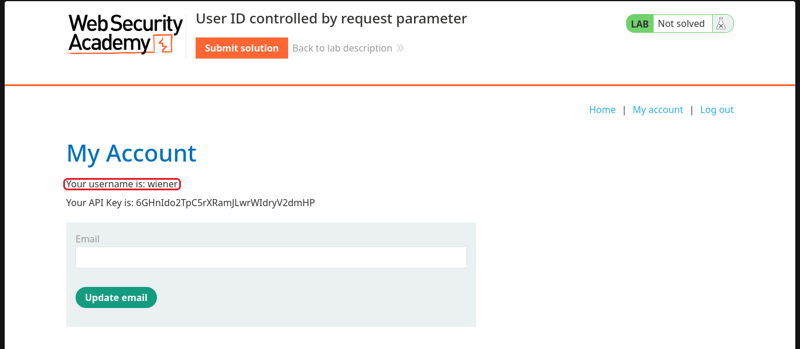
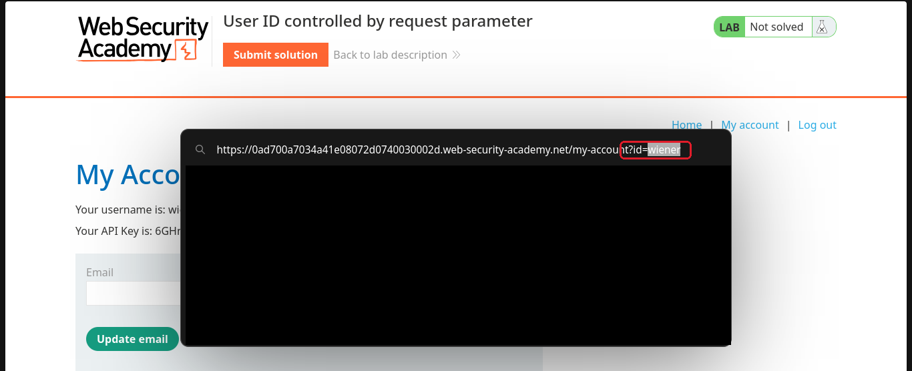
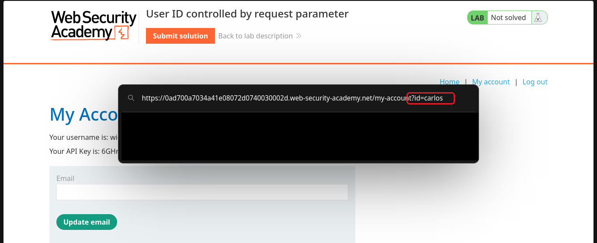
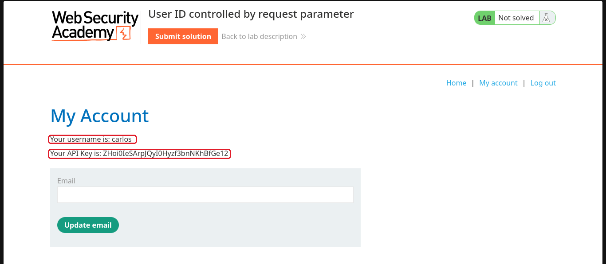
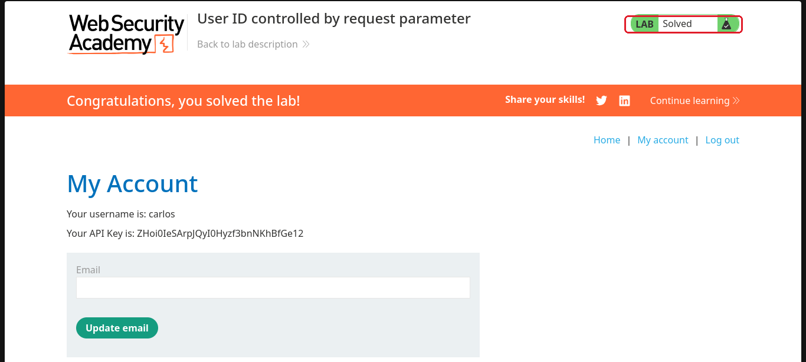

# User ID controlled by request parameter

**Plataforma:** [PortSwigger Web Security Academy](https://portswigger.net/web-security/access-control/lab-user-id-controlled-by-request-parameter)  
**Nível:** Apprentice  
**Tema:** controle de acesso (IDOR)  
**Ferramentas:** só o navegador  

## O objetivo

Entrar com a minha conta (wiener) e achar a API key de outro usuário, o carlos, para resolver o lab.

## Passo a passo

### 1. Olhar a minha conta

Fiz login como wiener. A página "My Account" mostra o meu nome de usuário e a minha API key.

### 2. Reparar no endereço

O endereço da página termina em `my-account?id=wiener`. Ou seja, quem decide qual conta aparecer é esse `id`, e o meu `id` é o meu próprio nome de usuário.

### 3. Trocar o id

Troquei `wiener` por `carlos` no endereço e dei enter.

### 4. Cair na conta do carlos

A página passou a mostrar a conta do carlos, com a API key dele, sem eu precisar da senha.

### 5. Lab resolvido

Colei a API key do carlos na solução.

## Por que funcionou

O site escolhe qual conta mostrar só pelo `id` que vem no endereço, e não confere se aquela conta é mesmo a minha. Isso é IDOR. O fato de o `id` ser o nome de usuário, que é fácil de adivinhar, deixa tudo mais simples, mas o problema de verdade é a falta dessa conferência.

## Como corrigir

- Antes de mostrar a conta, conferir se ela pertence a quem está logado.
- Não confiar em valor que veio do cliente para decidir o que a pessoa pode ver.

## O que eu aprendi

Quando um dado meu aparece no endereço, como um `id` ou um nome, vale testar trocar pelo de outra pessoa. É o teste mais direto de controle de acesso.
